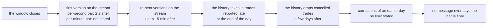
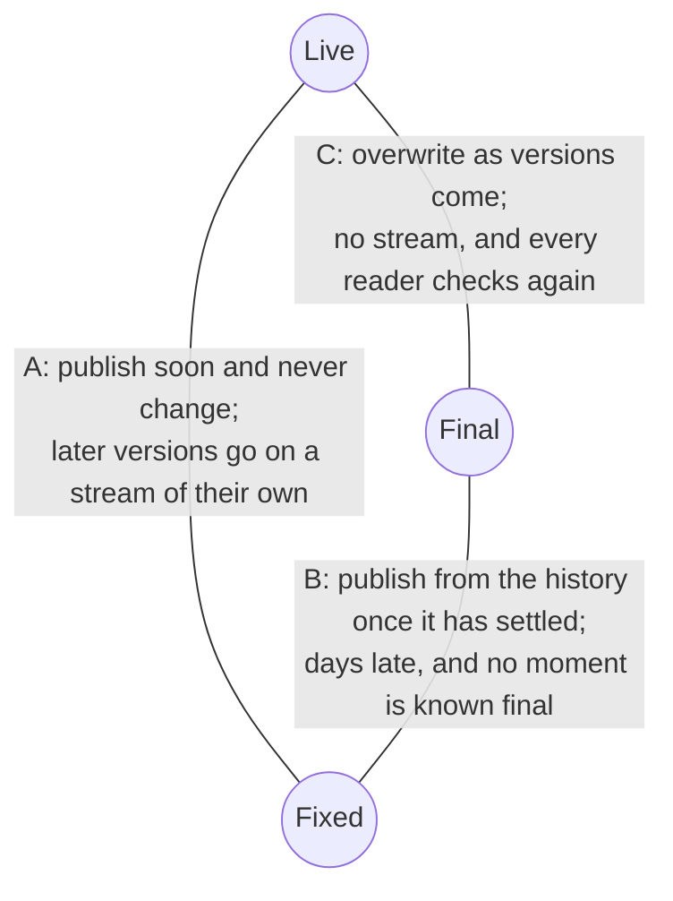

# Acquisition: the published stream's axioms against the vendor's stream

Acquisition reads the vendor's bars of one series and publishes them as a clean series. Everything downstream builds on the clean series and checks nothing again. This document sets the axioms the published stream must hold against the stream the vendor actually provides, states the gap, proves what cannot be had, and gives the two routes that remain. The Lean is `lean/CleanStream.lean`. The evidence, with its sources, is `docs/designs/research/stream.md`; the vendor is Massive, its bars of US stocks.

## The axioms of the published stream

The axioms are read from Kafka's topic partition, as the model of a stream (`docs/designs/research/stream.md`, Part 1). Kafka itself is not in the definition: in the Lean a stream is a Kahn log, which holds A1 to A4 by what a log is (`Kahn.Log`), and an implementation that carries a log, on Kafka say, shows that it keeps A5 to A7, so that each reader reads the log that was written.

- **A1.** One ordered sequence, which only grows at its end.
- **A2.** A record, once written, is never changed.
- **A3.** Each record has a fixed position, and positions increase along the sequence.
- **A4.** Every reader sees the same sequence, from any position it starts at, as often as it likes.
- **A5.** One writer's records are in the order it wrote them, also when a write is retried.
- **A6.** No record is in the sequence twice.
- **A7.** A record written is not lost.

The clean series adds one axiom of its own:

- **S.** The bars are in date order, one bar for each date, each bar's `index` is its position, and each bar keeps market's rules. The market contract states what a valid bar is, and its records are the form the components exchange bars in. In the Lean: `CleanStream.Valid`, with `CleanStream.Valid.date_inj` (one bar for each date).

## The vendor's stream

How the vendor's stream behaves (`docs/designs/research/stream.md`, Part 2, which gives the evidence for each). In the Lean the vendor's feed is the log of its statements as read (`CleanStream.Feed`), and features 1, 2, 4, 6 and 7 are stated of a feed (`Resent`, `OutOfOrder`, `Missing`, `Broken` and `NotYetBegun`, `RevisedAfter`), each shown on a sample feed of invented bars (`CleanStream.sample`, `sample_resent`, …):

1. One bar is sent several times, each time a new version, for up to 15 minutes after its window.
2. Bars do not arrive in date order: a re-sent bar is dated up to 15 minutes before bars already received.
3. No message says a bar is final, and its first version may be incomplete.
4. A window with no eligible trade has no bar. A missing bar is normal: one busy stock had bars in 885 of its 960 minutes.
5. There is no sequence number and no replay. A client that was disconnected gets nothing of what it missed, and the connection is reset every night.
6. A bar on the stream can be wrong: a trade reported more than 15 minutes late is left out, and a trade cancelled later stays in.
7. Corrections are never sent after 15 minutes. The history takes in late trades at the end of the day and drops cancelled trades a few days later. Nothing announces either: a client learns of a correction only by asking again and comparing.
8. A split rewrites the whole adjusted history, at any later time. The unadjusted history is the one the vendor advises keeping as a permanent record. A ticker can be renamed or reused.
9. A timestamp is the start of the bar's window, in UTC: milliseconds on the stream and in the history, nanoseconds in the daily files. A daily bar is stamped at midnight Eastern.
10. Only some trades count toward a bar, and price and volume count different trades.
11. The stream is real-time or 15 minutes delayed, by the plan.
12. The same bar differs in form, and can differ in value, between the stream, the history and the daily files.

## The gap

The vendor's stream holds none of the axioms. The one thing it gives is that the messages of one connection arrive in the order they were sent. Each row below is what acquisition has to do so that the published stream holds the axiom.

| Axiom | The vendor's stream | What acquisition has to do |
|---|---|---|
| A1 one sequence | each connection starts a new one; re-sent bars go back in time (1, 2, 5) | join every connection and the history into one sequence that outlives them, its order fixed by a rule |
| A2 never changed | the vendor tells clients to overwrite; the history changes later (1, 6, 7, 8) | publish a change of a bar as a further record, never as an edit; read unadjusted prices |
| A3 fixed positions | a bar has no number, only its start time, with holes where no trade counted (1, 4, 5) | give each bar its position by its own count; the date stays a field, never the position |
| A4 same for every reader | no replay; two clients see different things (5, 7, 8, 11) | read the vendor once, into one log; everything downstream reads that log, never the vendor |
| A5 the writer's order | no order of sending is stated (2) | rest the published order on nothing the vendor sends in |
| A6 no duplicate | the same bar is re-sent on purpose; the history repeats what the stream gave (1, 5, 12) | decide which version of a bar is the bar of the series, and where the other versions go |
| A7 nothing lost | nightly resets, nothing re-sent; a lost bar looks like a quiet minute (4, 5) | fill every gap of the connection from the history before going on |
| S date order, valid bars | out of date order, unnumbered, some bars wrong (2, 3, 6) | keep date order and number the bars itself; refuse and record a bar that breaks market's rules |

## What cannot be had

Three things are wanted of the clean series:

- **Live:** each bar is published within a fixed delay after its window closes.
- **Final:** each published bar is the vendor's last version of that bar.
- **Fixed:** a published bar is never changed, and the series keeps axiom S: one bar for each date, in date order.

All three at once cannot be had, and the Lean proves it: no process gives the clean data of every feed (`CleanStream.no_process`). The clean data of a feed is a clean stream holding, of each window, the vendor's last word on it (`CleanStream.CleanOf`); each feed has its clean data (`cleanOf_one`, `cleanOf_two`), but a process gives a bar for a feed of one statement, the feed with a changed bar of that window after it extends that feed, and a process never takes back what it has given. A bar's life on the vendor's side has no moment at which it is final:

The argument, in three steps:

1. **Final is never known.** The vendor can revise a bar within 15 minutes, at the end of the day and days later, states no last revision, and marks no bar final (features 1, 3, 7). So for any delay, a bar published at that delay may still be revised after it. Most bars are never revised after 15 minutes: that needs a trade reported more than 15 minutes late, or a trade cancelled or corrected, and the vendor counts a cancel in roughly one of 100,000 to 400,000 trades. What cannot be had is a guarantee that a bar is final, not a bar that is right.
2. **Live and Final exclude each other under Fixed.** A bar published within a fixed delay may be revised after it (step 1). Under Fixed the published bar cannot take the revision: changing it breaks A2, and a second bar of the same date breaks S. So the clean series holds the bar as known when it was published, not its last version.
3. **Without Fixed, the series is no stream.** A series whose bars are overwritten as revisions come breaks A2. A view that replaces a record already given is not a process (`Kafka.compaction_not_process`), so every reader of such a series has to check its bars again and take in corrections itself: the checking and re-checking all over the platform that the axioms are there to prevent.

So each way of building acquisition gives up one of the three:

- **A, Live and Fixed.** The clean series is each bar as known at a fixed delay after its window, never changed. The versions after that delay, and the history's later revisions, are published apart, on the corrections stream. The cost: a clean bar can differ from the vendor's last version. By the vendor's account, a trade is cancelled in roughly one of 100,000 to 400,000 trades, and every settled session checked had at least one. The delay is a parameter: at the close, the stream's re-sends all become corrections; 15 minutes after the close, the stream's last word is taken and only the history's revisions are corrections, at the cost of every clean bar being 15 minutes late.
- **B, Final and Fixed.** The clean series is read from the history once it has settled. It is not live, and even then no moment is known to be final (step 1), so it is final only as far as anyone can know.
- **C, Live and Final.** It breaks the axioms (step 3). It is listed to show why it is not taken.

Two more limits follow from the vendor's stream, whichever way is taken:

- **A lost bar and a quiet minute look the same on the stream** (features 4, 5). Only the history tells them apart, so completeness rests on reading the history for every gap of the connection, and on the history itself being whole, which is an assumption.
- **A bar first seen late cannot join the clean series in date order** (features 2, 4): a bar the history shows for a window the stream had nothing for, after later bars were published, would break S. Under A or B it is a correction too.

## The corollary: two routes

The theorem leaves two routes. On the first, the clean data is made outside the streaming system and the stream is fed from its store: the stream holds the clean data of a snapshot, and acquisition cleans nothing. On the second, acquisition works on the vendor's data in the stream: by the theorem, what the stream then holds is not the clean data but each bar as known at a fixed delay. The first is way B above, made again at each snapshot; the second is way A. Both give the components downstream a stream that never changes, so nothing downstream checks again.

## Route 1: the clean data made outside the stream

- **Recording.** The vendor's statements are appended, as read, to a raw store: each bar as the vendor gave it, on the stream or from the history, with the time it was read, prices unadjusted. Nothing in it is refused, merged or overwritten.
- **Construction, outside the streaming system.** From a snapshot of the raw store, a finite list of statements taken as complete, a function makes the snapshot's clean data: its last words on each window, those that keep market's rules, in date order, each at its place (`CleanStream.construct`). What it makes is the snapshot's clean data (`CleanStream.cleanOf_construct`). It is a function, not a process: it may be run again on a later snapshot and give a different series, which is what the theorem forbids a process. It is written to the clean store, with the time of its snapshot. All the cleaning work in `docs/designs/research/acquisition.md` belongs here.
- **Acquisition feeds the stream from the clean store** and cleans nothing (`CleanStream.feed`). The stream then holds the snapshot's clean data (`CleanStream.store_route`; on the sample feed, `CleanStream.sample_clean`).
- **Versions.** While the clean store is only extended, the stream follows it, as a process does. A construction that changes bars already fed makes a new version of the stream, which its readers read from its start: a stream cannot follow a rewrite of its store.
- **The bar still forming,** for the live chart, comes from the vendor's live statements, not from the clean store: it is for display, not clean data.
- **What it gives:** the stream holds the clean data, as of its snapshot. **What it costs:** the stream is as fresh as the last construction, and a construction that revises bars already fed costs a new version.
- **Its parameters:** how often the construction runs, on what snapshot; when a revision makes a new version, and how far back a construction reaches.

## Route 2: the vendor's data in the stream

- **The raw topic** is the log of the vendor's statements as read: each bar as the vendor gave it, with the time it was read, prices unadjusted, nothing refused, merged or overwritten. At the start and after each disconnect, acquisition reads the history for the gap before it goes on with the stream. Besides the statements, acquisition writes watermarks, each a time up to which it has read the vendor with no gap: while connected, at a fixed interval; after a disconnect, none until the history has filled the gap.
- **The settled series** is computed from the raw topic by one rule, with the settling delay `d`. A window settles at the first watermark at or after its end plus `d`; its last version read by then enters the settled series if it keeps market's rules, and is refused and recorded if not. Windows settle in the order of their ends, so the series is in date order with no rule on dates. A version read after its window settled goes on the corrections topic. A bar of a window not yet begun when read is refused. The versions before a window settles are its bar still forming, which the chart reads.
- **Time is in the data:** a process sees only its input, so a rule that waits needs the time in the log, and the watermark is that time.
- **What it gives:** a live stream, `d` behind the market, that never changes. **What it costs:** by the theorem it is not the clean data. It is each bar as the vendor had given it by `d` after its window, and it differs from the clean data on each window the vendor revises after that; each difference is on the corrections topic. Acquisition has a part that settles and refuses, though not the cleaning work of route 1.
- **Its parameters:** the settling delay `d`, 15 minutes for this vendor's real-time stream, the time in which it re-sends a bar; the watermark interval; the feed, real-time or delayed.
- **Not yet in the Lean:** the settling rule as a process, and the theorem that it gives the clean data exactly when the vendor revises no window after it settles.

## Parameters of both routes

- **The series' signature:** the security, the market, the exchange, the source and the period (`Acquisition.Signature`). It sets which series the working space is, and the names of its streams.
- **The feed:** the vendor's real-time stream or its 15-minute delayed one (feature 11).

## What it means for the design so far

- The raw topic held the vendor's raw series of k-lines, and the corrections came from an input of their own. On either route the vendor's data is recorded as statements, with the time each was read.
- The cleaner's rule on dates, to keep a bar only if it is dated after every kept bar, goes. On route 1 there is no cleaner in the stream; on route 2 date order comes from settling, and a later version of a bar is a correction, not an error.
- The streams are logs, not Kafka topics: the implementation that carries them on Kafka shows that each reader reads the log written. The rest of the Lean still has Kafka's topic in it.
- `docs/designs/spec.md` and the rest of the Lean follow once a route is taken.

## What is left

- Which route the platform takes, or both: route 1 for the stored clean data, route 2 for the live stream.
- On route 1: when the construction runs, and when a revision makes a new version.
- On route 2: the settling rule in the Lean, with its theorem; the value of `d` for the delayed stream, whose handling of re-sent bars the vendor does not state.
- When the vendor's history is read again to find its later revisions (at the end of the day, days later), and how far back: the vendor announces none (feature 7).
- Whether a statement records which feed it came from, the stream or the history.
- Whether a per-minute bar is first sent before its minute ends. Only watching the stream settles it.
