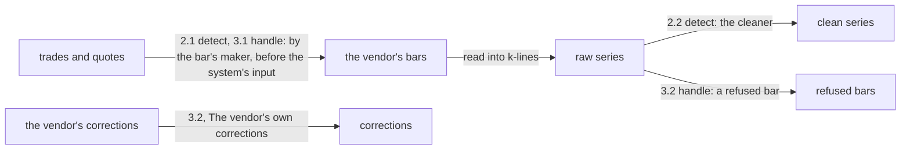

# Acquisition: the research behind its spec

This file covers the algorithmic and engineering issues behind acquisition's spec, in the outline below. `docs/designs/spec.md` (Acquisition, and Reading a series back from its topic) states what the component must do; this file says what is known that makes those statements right, and what choices it leaves.

Sources are marked by how each was read: [READ] read in full at the part cited; [SUMMARY] from a search or fetch summary only; [INFER] an inference, not stated by a source. Each source marked [READ] was read from its own page or file at the part cited, with these copies: the Barndorff-Nielsen, Hansen, Lunde and Shephard paper at the Internet Archive's copy of its authors' PDF (not the journal's pages); the FIX session text at a dictionary site's reproduction of FIXT 1.1 (the FIX Trading Community's own page returned nothing); CME's pages through the content interface of CME's client wiki, in its space named EPICSANDBOX; Lee and Mykland, and Holden and Jacobsen, at their authors' university pages; Verousis and ap Gwilym at the Internet Archive's copy of a university repository's file; Aït-Sahalia, Mykland and Zhang as a university technical report, Christensen, Oomen and Podolskij as a working paper, Andersen, Dobrev and Schaumburg as a central bank's staff report, and Corwin and Schultz as a conference draft, none at its journal's pages; Bandi, Pirino and Renò at a university repository; CRSP's guides at copies on university servers, CRSP's own guide addresses returning no page; the Olsen filter at its patent, whose page prints formulas in line with their fraction bars lost; Aït-Sahalia, Mykland and Zhang's comment, Zhang, Mykland and Aït-Sahalia, Jacod, Li, Mykland, Podolskij and Vetter (a technical report of 2007, not the journal's pages) and Mykland and Zhang at an author's university page; Hansen and Lunde as a working paper of September 2004 at a university's copy, and Oomen as a working paper at a university repository; Christensen and Podolskij at arXiv; Corsi, Peluso and Audrino as an accepted version at a university repository; Lo and MacKinlay as an NBER working paper, a scan with no text, read as images of its pages 1 to 8 of 39; the NYSE specification at a university's copy of version 2.0, NYSE's own pages refusing the request; CRSP's flags at two tables on CRSP's site; the Eagle pages through the content interface of its wiki; Cahan, Bai and Ng, and Chen and McCoy, at their abstracts alone. Code is cited at a fixed commit. A statement about the definition is marked [READ] where it was checked against `lean/`. Formulas are written here in plain characters. Parts 2.1, 2.2 and 3.1 hold the Brownlees and Gallo rule, the steps P1, P2, Q4, T1 and T2 of Barndorff-Nielsen, Hansen, Lunde and Shephard, and Falkenberry's statements on bars, on filtering in real time and on replacing a price; they are pointed to and not restated.

## The outline

Sections 2 and 3 are each on ticks, the trades and quotes a bar is made from, and on bars, the k-lines:

| | On ticks | On bars |
|---|---|---|
| **Error detection** | [2.1 On ticks](#21-on-ticks) | [2.2 On bars](#22-on-bars) |
| **Error handling and correction** | [3.1 On ticks](#31-on-ticks) | [3.2 On bars](#32-on-bars) |

- [1. What clean is, and where it is checked](#1-what-clean-is-and-where-it-is-checked)
- [2. Error detection](#2-error-detection)
  - [2.1 On ticks](#21-on-ticks):
    - [Rule lists on ticks](#rule-lists-on-ticks)
    - [Neighbourhood rules: a centre, a scale and a threshold](#neighbourhood-rules-a-centre-a-scale-and-a-threshold)
    - [Adaptive filters of data vendors](#adaptive-filters-of-data-vendors)
    - [Reversal rules](#reversal-rules)
    - [Jump tests, and estimators that need no cleaning](#jump-tests-and-estimators-that-need-no-cleaning)
    - [Stale and repeated prices](#stale-and-repeated-prices)
  - [2.2 On bars](#22-on-bars):
    - [A bar's own rules](#a-bars-own-rules)
    - [A series' order and dates](#a-series-order-and-dates)
    - [Versions and duplicates of one bar](#versions-and-duplicates-of-one-bar)
    - [Missing bars](#missing-bars)
    - [A bar against its neighbours](#a-bar-against-its-neighbours)
    - [A second source](#a-second-source)
    - [Corporate actions](#corporate-actions)
  - [Across the algorithms](#across-the-algorithms)
- [3. Error handling and correction](#3-error-handling-and-correction)
  - [3.1 On ticks](#31-on-ticks):
    - [Deleting, as measured](#deleting-as-measured)
    - [Keeping every tick: the error in the model](#keeping-every-tick-the-error-in-the-model)
    - [Sampling ticks on a grid: the previous tick and linear interpolation](#sampling-ticks-on-a-grid-the-previous-tick-and-linear-interpolation)
    - [The exchange's marks on a tick](#the-exchanges-marks-on-a-tick)
    - [Across what is done on ticks](#across-what-is-done-on-ticks)
  - [3.2 On bars](#32-on-bars):
    - [Drop](#drop)
    - [Drop and record](#drop-and-record)
    - [Flag](#flag)
    - [Fill a missing bar](#fill-a-missing-bar)
    - [Impute a missing value](#impute-a-missing-value)
    - [Repair of a bar's high and low](#repair-of-a-bars-high-and-low)
    - [Bound or down-weight a return](#bound-or-down-weight-a-return)
    - [Adjustment for corporate actions](#adjustment-for-corporate-actions)
    - [Continuous futures series](#continuous-futures-series)
    - [Several sources merged into one series](#several-sources-merged-into-one-series)
    - [The vendor's own corrections](#the-vendors-own-corrections)
- [4. Gaps](#4-gaps)

Where each part bears on the data's path:

## 1. What clean is, and where it is checked

**Kind:** modelling. **Bears on:** "the vendor's series, raw and clean ... each kind on a topic of its own" (Objectives); "Cleaning in acquisition, not in warehousing" (Features); `cleaner`, `publishRaw`, `publishClean` (Requirements).

No source gives a truth to check a value against. A transport guarantees delivery, not content: "The meaning of the data is application specific" ([MoldUDP64 Protocol Specification V 1.00](https://www.nasdaqtrader.com/content/technicalsupport/specifications/dataproducts/moldudp64.pdf)) [READ]. An exchange's data "is raw, in that the NYSE does not guarantee the degree of accuracy of the data" ([Brownlees and Gallo, Financial Econometric Analysis at Ultra-High Frequency: Data Handling Concerns, 2006, section 2.4](https://labdisia.disia.unifi.it/area01/pubblicazioni_DS/wp/2006/wp2006_03.pdf)) [READ]. A bar is one vendor's reading of the trades: sale conditions decide which trades count, vendors apply them differently, and "There is no universal source of truth for OHLC" ([Massive, How does Massive create aggregate bars?](https://massive.com/knowledge-base/article/how-does-massive-create-aggregate-bars)) [READ]. A maker of cleaned ticks says "there is no single correct scrubbed time series" ([Falkenberry, High Frequency Data Filtering, Tick Data](https://s3-us-west-2.amazonaws.com/tick-data-s3/pdf/Tick_Data_Filtering_White_Paper.pdf)) [READ]. [INFER] So "clean" is conformance to stated rules, a claim about a process applied to the data, never the truth of a value.

Systems that make the claim at scale define it so. Google's validation rests on "a data schema, which codifies the expectations for correct data", kept "as a production asset at par with source code", and checks the whole batch ([Breck, Polyzotis, Roy, Whang and Zinkevich, Data Validation for Machine Learning, SysML 2019](https://mlsys.org/Conferences/2019/doc/2019/167.pdf)) [READ]. Amazon's Deequ lets data producers "halt their data publishing pipelines when they encounter cases of data anomalies", so that consumers work on "vetted data", and states "we do not support the automatic execution of data repair methods" ([Schelter, Lange, Schmidt, Celikel, Biessmann and Grafberger, Automating Large-Scale Data Quality Verification, PVLDB 11(12), 2018](https://www.vldb.org/pvldb/vol11/p1781-schelter.pdf)) [READ].

Where the check runs differs. The lakehouse layering checks once, between a raw layer that is kept and a clean one made from it: the raw layer "Contains and maintains the raw state of the data source in its original formats" and "Enables reprocessing and auditing by retaining all historical data", and "Databricks does not recommend writing to silver tables directly from ingestion" ([Databricks, What is the medallion lakehouse architecture?](https://docs.databricks.com/aws/en/lakehouse/medallion)) [READ]. Google checks again at each consuming pipeline, for a stated reason: "the generation (and ownership!) of the data is decoupled from the ML pipeline" ([Breck et al.](https://mlsys.org/Conferences/2019/doc/2019/167.pdf)) [READ]; Deequ's answer to a consumer's own expectation is that "the producer can choose to adapt checks from downstream consumers earlier in the data processing pipeline" ([Schelter et al.](https://www.vldb.org/pvldb/vol11/p1781-schelter.pdf)) [READ]. [INFER] Checking once is sound where producer and consumers hold one written rule; here the record rules are the contract's (`Market.KLine.Keeps`) and the date rule the spec's, each stated once.

A record that fails is dropped with a trace. A Databricks rule has one of three actions: keep and count, drop ("The count of dropped records is logged alongside other dataset metrics"), or fail the update, for which "metrics are not recorded"; its quarantine pattern gives the refused rows a view of their own ([Databricks, Manage data quality with pipeline expectations](https://docs.databricks.com/aws/en/dlt/expectations), [Expectation recommendations and advanced patterns](https://docs.databricks.com/aws/en/ldp/expectation-patterns)) [READ]. kdb+'s recovery replays a log through an error trap that collects each failing message in a variable, `baddata` ([KX, Data recovery for kdb+tick](https://code.kx.com/q/wp/data-recovery/)) [READ]. A trading engine's reader reports a line it cannot parse and goes on ([QuantConnect LEAN, TextSubscriptionDataSourceReader.cs](https://github.com/QuantConnect/Lean/blob/d1c09284c438b70eb965b7dc40f44e7dca69e7b5/Engine/DataFeeds/TextSubscriptionDataSourceReader.cs)) [READ].

A check made where a record is built does not hold where it is read by code that skips it: a trading engine's `Bar::new_checked` requires `high >= open`, `high >= low`, `high >= close`, `low <= close`, `low <= open`, while its decoder of stored bars builds the bar without them ([NautilusTrader, bar.rs](https://github.com/nautechsystems/nautilus_trader/blob/c3bde0c1b8d1b120c78146b7923ea266323234ba/crates/model/src/data/bar.rs), [arrow/bar.rs](https://github.com/nautechsystems/nautilus_trader/blob/c3bde0c1b8d1b120c78146b7923ea266323234ba/crates/serialization/src/arrow/bar.rs)) [READ]. [INFER] What a consumer reads from a topic is bytes: it checks again or trusts the writer.

The definition as it stands [READ]. `Acquisition.cleaner` is a `Process Series Series`, `Series` being `Log Market.KLine`, and nothing more is required of it: "What a part gives is the implementation's: that the reader gives the vendor's series, the cleaner a clean one, and the topic of a kind holds its series, is not required here, and is not a theorem" (`lean/Acquisition.lean`). The spec names `Acquisition.clean` and `Acquisition.Spec`; `lean/` holds neither. `Market.KLine.Keeps` has three rules, `finite`, `range` and `volumeNotNegative`, and `Market.broken KLine.rules k` gives the names of those `k` breaks: the contract already yields the reason of a refusal by a record rule. The spec's date rule is of the series, not of a record, and has no name. Each topic carries `KLine` alone, which has no field for a verdict, a reason or a rule set's version.

**The options.**
- Refusal by absence (the spec as written): a refused k-line is in the raw series and not in the clean one. That it was refused shows only by comparing the two, and why only by applying the rules again (`Market.broken` for a record rule; the series' whole prefix for the date rule).
- A refused bar kept with its reason, and a rule set with a version: in 3.2, Drop and record.

**What it gives the spec.** [INFER] The objective's "raw and clean" with "each kind on a topic of its own", the feature "Cleaning in acquisition" and `cleaner`'s "never repaired" rest on this: that clean is conformance to written rules, every source read agrees; a check made once at the producer, from a raw that is kept, with no repair, is the lakehouse's and Deequ's form, while Google checks again at each consumer, where producer and consumer share no rule, and one vendor's tick filter replaces a bad price (3.1). What is left open is in 3.2, Drop and record.

## 2. Error detection

The algorithms of market-data cleaning, in 2.1, 2.2 and 3. **Kind:** algorithm; a survey of the algorithms, each taken on its own terms: the batch ones, run on a whole series once it is had, and two that judge a point as it comes and read none after it (Tick Data's filter and the Olsen filter's real-time mode, in 2.1).

### 2.1 On ticks

What is checked on trades and quotes, before a bar is made. What each algorithm does with a point it judges bad, its Acts line, is in 3.1; what of it applies to bars is in 2.2, A bar against its neighbours.

What a bar hides. "We estimate that the high or low of daily data, or any intraday bar, is set on a bad tick far more frequently than is currently perceived"; the example is a day's low set by one print 1.50 below the ticks around it; "Data must be cleaned at its finest granularity" ([Falkenberry](https://s3-us-west-2.amazonaws.com/tick-data-s3/pdf/Tick_Data_Filtering_White_Paper.pdf)) [READ]. [INFER] A bad print inside a bar moves its high or low and the bar still keeps `range`; a cleaner of bars has no ticks, so that error is removed by the bar's maker or by no one. The maker does filter: Massive counts eligible trades only ([Massive, How does Massive create aggregate bars?](https://massive.com/knowledge-base/article/how-does-massive-create-aggregate-bars)) [READ], as the published "T1. Delete entries with corrected trades" and "T2. Delete entries with abnormal Sale Condition" do ([Barndorff-Nielsen et al., section 3.1](https://web.archive.org/web/20240801055231/https://scholar.harvard.edu/sites/scholar.harvard.edu/files/RKpractice-ECTJ.pdf)) [READ].

#### Rule lists on ticks

The realised-kernel procedure has six steps beyond those in 2.2 and in this part: "P3. Retain entries originating from a single exchange (NYSE in our application). Delete other entries."; "Q1. When multiple quotes have the same timestamp, we replace all these with a single entry with the median bid and median ask price."; "Q2. Delete entries for which the spread is negative."; "Q3. Delete entries for which the spread is more that 50 times the median spread on that day."; "T3. If multiple transactions have the same time stamp: use the median price."; "T4. Delete entries with prices that are above the ask plus the bid-ask spread. Similar for entries with prices below the bid minus the bid-ask spread." P1 to P3 apply to trades and quotes, T1 to T4 to trades, Q1 to Q4 to quotes ([Barndorff-Nielsen, Hansen, Lunde and Shephard, Realised Kernels in Practice: Trades and Quotes, section 3.1](https://web.archive.org/web/20240801055231/https://scholar.harvard.edu/sites/scholar.harvard.edu/files/RKpractice-ECTJ.pdf)) [READ].

What each step is for, and how much it takes. Beyond the errors of price 2.2 quotes (A bar's own rules), P2 and T1 remove "timestamps that may be way off", and "T2 rules out datapoints which the TAQ database is flagging up as a problem"; "By far the most important rules here are P3, T3 and Q1", and "it is these rules which lead to the largest deletion of data"; P3 "is used to reduce the impact of time-delays in the reporting of trades and quote updates"; "We use Q4 to get the outliers that are missed by Q3". For Alcoa on the NYSE on one day (24 January 2007), of 7,276 trades T3 takes 2,299 and T4 5, and of 42,121 quotes Q1 takes 28,205 and Q4 68; P2, T1, T2, Q2 and Q3 take none. T4 "disciplines the trade data using quotes", "cannot be applied when quote data is not available", "is rarely activated in practice", and "the RK estimator (unlike the RV statistic) is not very sensitive to the use of T4". The reason given for deleting at all: "The realised kernel and related estimators "treat all observations equally" and a few outliers can severely influence these estimators", and, of an earlier paper, "tossing out a large number of observations can in fact improve volatility estimators" ([Barndorff-Nielsen et al., sections 3 and 3.2, Table 1](https://web.archive.org/web/20240801055231/https://scholar.harvard.edu/sites/scholar.harvard.edu/files/RKpractice-ECTJ.pdf)) [READ].

- Needs: ticks with their exchange, correction and sale-condition fields, the session's hours, and quotes for T4. A jump and an error: T1 and T2 take the database's own marks, and P2 a zero price, which is a value and no mark (2.2, A bar's own rules); Q3, Q4 and T4 are thresholds (50 median spreads, 10 deviations, one spread), and [INFER] no step asks whether a deleted price was a jump. Measured: the counts above, and the estimator's sensitivity to T4.

The list as code. An R package's `tradesCleanup` runs, in this order: `PRICE != 0`; the exchange's hours (default "09:30:00" to "16:00:00"); one exchange, chosen or `"auto"`; `CORR == 0`; a list of valid sale conditions; and `mergeTradesSameTimestamp` with `selection = "median"`; it returns the count each step removed. `quotesCleanup` runs `BID != 0 & OFR != 0`, the hours, the exchange, `OFR>BID` (so a zero spread goes too), `SPREAD < (SPREAD_MEDIAN * maxi)`, the merge of equal time stamps and `rmOutliersQuotes`. `rmTradeOutliersUsingQuotes` keeps `PRICE <= OFR + nSpreads * SPREAD & PRICE >= BID - nSpreads * SPREAD`, `nSpreads = 1` by default, after matching each trade to a quote, with `lagQuotes = 0` by default and the advice that "For older datasets, i.e. before 2010, it may be a good idea to set this to e.g. 2". The file's `makeOHLCV` makes bars from prices (`OPEN = first(PRICE), HIGH = max(PRICE), LOW = min(PRICE), CLOSE = last(PRICE)`, `VOLUME = sum(SIZE)`) ([highfrequency, R/dataHandling.R](https://github.com/jonathancornelissen/highfrequency/blob/eb0e84898ce1c44142726412529bbcf9e296a066/R/dataHandling.R)) [READ]. [INFER] By its name and its arguments, no function the file defines takes bars to clean.

Quote rules for a consolidated tape. Holden and Jacobsen's base screens: "Only quotes/trades during normal market hours (quotes between 9:00 a.m. and 4:00 p.m. and trades between 9:30 a.m. and 4:00 p.m.) are considered"; "we delete cases in which the bid of one exchange or market maker is greater than or equal to the ask of the same exchange or market maker"; "If the quoted spread is greater than $5.00 and the bid (ask) price is less (greater) than the previous midpoint − $2.50 (previous midpoint + $2.50), then the bid (ask) is not considered"; "The quote condition must be normal, which excludes cases in which trading has been halted". Their three additions for the second-stamped database: a withdrawn quote ("when a bid (ask) price or bid (ask) size equals zero or a missing value, we assume that the bid (ask) quote has been withdrawn and set it to missing", which "avoids using stale quotes"); Interpolated Time, which "uses the ordering of trades and quotes within a second to make an educated guess about the millisecond in which the events occurred"; and "we delete NBBO quotes whenever the NBBO is crossed or locked" with "any trades that occur while the NBBO is crossed or locked". Measured against the millisecond database, on 100 firms over April to June 2008: unadjusted, "the percent effective spread is 54% larger", "trades outside the NBBO happen eight times more often" and "the percent price impact is 109% larger"; with the three techniques "the percent quoted spread difference (relative to DTAQ) is completely eliminated", "the percent effective spread difference is reduced by 91%" and "the outside-the-NBBO difference is reduced by 90%" ([Holden and Jacobsen, Liquidity Measurement Problems in Fast, Competitive Markets: Expensive and Cheap Solutions, Journal of Finance 69(4), 2014, introduction and the section on its data](https://host.kelley.iu.edu/cholden/Holden%20and%20Jacobsen%20(2014).pdf)) [READ].

- Needs: every exchange's quotes, their condition codes, the order of records within a second. A jump and an error: a crossed or locked NBBO is one of the "economically nonsensical states" whose quotes and trades the paper deletes ([Holden and Jacobsen, introduction](https://host.kelley.iu.edu/cholden/Holden%20and%20Jacobsen%20(2014).pdf)) [READ]; [INFER] that test and the first screen's (a bid at or above the same exchange's ask) are of a state, and one screen alone is of a price's size, the third above ($5.00 of spread, $2.50 from the previous midpoint).

Return rules. A survey of the literature lists what is "commonly omitted": records "before the market open and after the market close", "Quotes or trades with negative or zero prices", "Trades with non-positive volume", and "Trades that are cancelled or identified by the exchange as errors". It reports a set of rules it calls widely used, in which "trades (quotes) are classified as outliers when returns on trades (quotes) are greater than 10%", "quotes are deleted when spreads are negative or greater than $4", and prices that "are not multiples of the minimum tick" are deleted; and it reports other authors' thresholds of 50% and 25%, "signifying that data selection rules in UHFD are always prone to somewhat arbitrary data selection rules" ([Verousis and ap Gwilym, An improved algorithm for cleaning Ultra High Frequency data, Journal of Derivatives and Hedge Funds 15(4), 2010, Existing studies](https://web.archive.org/web/20231203133638/https://repository.essex.ac.uk/24190/1/An%20improved%20algorithm%20for%20cleaning%20Ultra%20High%20Frequency%20data.pdf)) [READ]; the rules themselves are another paper's, taken here as this one reports them.

#### Neighbourhood rules: a centre, a scale and a threshold

The published neighbour rules are for ticks, within one trading day. Brownlees and Gallo keep observation i when `|p_i − p̄_i(k)| < 3 s_i(k) + γ`, "where p̄i(k) and si(k) denote respectively the 10% trimmed sample mean and sample standard deviation of a neighborhood of k observations around i and γ is a granularity parameter"; in mid-day the neighbourhood is "approximately the first preceding k/2 ticks and the following k/2 ones"; γ guards runs of equal prices and "should be a multiple of the minimum price variation allowed for the specific stock"; k follows trading intensity; "The procedure is inevitably heuristic" ([Brownlees and Gallo, section 3.1](https://labdisia.disia.unifi.it/area01/pubblicazioni_DS/wp/2006/wp2006_03.pdf)) [READ]. Barndorff-Nielsen, Hansen, Lunde and Shephard: "Q4. Delete entries for which the mid-quote deviated by more than 10 mean absolute deviations from a rolling centered median (excluding the observation under consideration) of 50 observations (25 observations before and 25 after)", which applies to prices where there are no quotes; the median and the mean absolute deviation are "less sensitive to runs of outliers"; "The choice of 50 observations for the window is ad hoc" ([Barndorff-Nielsen et al., sections 3.1 and 3.2](https://web.archive.org/web/20240801055231/https://scholar.harvard.edu/sites/scholar.harvard.edu/files/RKpractice-ECTJ.pdf)) [READ].

Both rules look ahead; a rule that looks back only has stated costs. A filter for live data should "Not introduce excessive delay due to computation time or the need for excessive confirming data points, i.e. a suspected bad tick at time t being confirmed by future prices generated at time t+1, t+2, etc.", and "Treating data differently in real time versus historical simulation can be risky". Tick Data's filter, which looks back only, takes the first true print out of a quiet stretch for a bad one, and cannot judge a session's first ticks ("The overnight or weekend gap effect renders the first tick of the day unfilterable") ([Falkenberry](https://s3-us-west-2.amazonaws.com/tick-data-s3/pdf/Tick_Data_Filtering_White_Paper.pdf)) [READ].

Brownlees and Gallo's rule (above) beyond its formula. The alternative it sets aside compares "each quote to the medians of the three preceding and the three following observations", removing it "if it is outside a fixed distance from those medians". Its own parameters are chosen by eye: a bar chart of price changes "guided the choice of the granularity parameter γ"; the rule is run over k from 40 to 80 and γ from USD 0.02 to 0.06; "The cleaning procedure turns out to be sensitive to the choice of γ, more than it is to the choice of k"; "The judgment on the quality of the cleaning can be had only by a visual inspection of the clean tick-by-tick price series graphs. In our view, a choice of k = 60, γ = 0.02 provides the most satisfactory results". Measured, on one stock for one month: with γ = 0.02 the rule removes 638 to 659 ticks, with γ = 0.06 248 to 302; at k = 60, γ = 0.02 it removes 647, 0.18% of the raw observations; the series of price-change durations falls from 1,121 observations of mean 423 seconds to 843 of mean 566, because "The presence of outliers in the data has the effect of splitting one "true" duration into at least two smaller ones", and the fitted model's coefficients "are quite different". Trades of one time stamp are replaced by one at their median ([Brownlees and Gallo, sections 3.1 and 4, Tables 5 to 7](https://labdisia.disia.unifi.it/area01/pubblicazioni_DS/wp/2006/wp2006_03.pdf)) [READ].

- Needs: the ticks of one trading day, k/2 on each side of the tick judged (the day's first and last ticks are judged against the first and last k), and the stock's minimum price variation. A jump and an error: [INFER] not told apart; a price that leaves its neighbourhood's trimmed mean by 3 standard deviations and γ is removed, and the first ticks at a new level are in that case until the window fills with the new level. Measured: counts and the effect on one model; no rate of true ticks removed.

The realised-kernel Q4 against it, and the R package's change. The authors of Q4 call it "very closely related" to the rule above: "We use the median in place of the trimmed sample mean ... and the mean absolute deviation from the median in place of" the standard deviation, for the reason quoted above ([Barndorff-Nielsen et al., section 3.2](https://web.archive.org/web/20240801055231/https://scholar.harvard.edu/sites/scholar.harvard.edu/files/RKpractice-ECTJ.pdf)) [READ]. The R package's `rmOutliersTrades` and `rmOutliersQuotes` (defaults `maxi = 10, window = 50, type = "advanced"`) differ in two ways. The scale is `mad(PRICE)` over the whole day and symbol, not the window ("NOTE: Median Absolute deviation chosen contrary to Barndorff-Nielsen et al."). And the default type keeps a price when `pmin` of its distances to three medians, the centred one excluding the price, the one of the `window` prices before and the one of the `window` prices after, is below `maxi * MADALL`; the stated reason is that "it will not incorrectly remove large price jumps" ([highfrequency, R/dataHandling.R](https://github.com/jonathancornelissen/highfrequency/blob/eb0e84898ce1c44142726412529bbcf9e296a066/R/dataHandling.R)) [READ]. [INFER] This rule names the jump, as two others read do (Verousis and ap Gwilym's rule in stages and the Olsen filter's after-jump rule, both below): a price is kept if it agrees with either side alone, so a level shift survives and an isolated print, agreeing with neither side, does not; the same test keeps a run of bad prints as long as the window.

The Hampel filter. As one numerical library codes it, for each point at least `k` from either end: `x0 <- median( x[(i-k):(i+k)] )`, `S0 <- L * median( abs(x[(i-k):(i+k)] - x0) )` with `L <- 1.4826`, "constants for normal distributions", and `if ( abs(x[i]-x0) > t0 * S0 )` then `y[i] <- x0`; the default `t0 = 3` is called "Pearson's 3 sigma edit rule", `t0<-0` gives "John Tukey's median filter", and "At the lower and upper end the time series values are preserved". Its own note: "Don't take the expression outlier too serious. It's just a hint to values in the time series that appear to be unusual in the vicinity of their neighbors under a normal distribution assumption" ([pracma, R/hampel.R](https://github.com/cran/pracma/blob/cdbf2d271faf031bc28bed3389de81a9fabc3504/R/hampel.R), [man/hampel.Rd](https://github.com/cran/pracma/blob/cdbf2d271faf031bc28bed3389de81a9fabc3504/man/hampel.Rd)) [READ].

- Needs: `k` neighbours on each side; no market input. A jump and an error: [INFER] not told apart; where more than half the window holds one value the scale is zero and every other point in it is replaced, the case the granularity term γ and the R package's whole-day scale each guard against.

A rule in stages, for low-priced contracts. Verousis and ap Gwilym name four effects a filter must meet, "the minimum tick size, the price level, the volatility of prices and the distribution of returns", and say earlier rules "may tend to "overscrub" a dataset": with a tick of 0.5 pence "an asset that is priced at 3p with a previous price of 2.5p will be classified as an outlier" by a 10% return rule. Their steps: cancelled and block trades, records outside the session and those with "zero or non-positive volume" are deleted; a price change below the minimum tick is kept at once; for a price at or below 20p a possible outlier has "absolute return greater than 20%" and a price "outside a 20% window around the mean daily price"; above 20p the bounds are 10%; then the statistical test, with "MAD = median{|p1 - μ|}", "μ is the daily median value", "one standard deviation from the mean is 1.4826 x MAD", and an outlier a value beyond "2.9652 x MAD"; and "Only those observations that are identified as outliers from both techniques are eventually discarded". Measured on 28 option contracts for one year: the 10% return rule marks 13.82% to 24.33% of trades; the staged rule marks 0.01% to 0.07% of quotes; and the correlation between a contract's price level and its share of outliers falls from 64% under the return rule to near zero. Their bound from the literature: "data selection models typically should not reject more than 1%". Their caution on all such measures: "the actual "clean" dataset is not observable, hence it is difficult to evaluate the efficacy of any filter" ([Verousis and ap Gwilym, Steps, Algorithm, Results](https://web.archive.org/web/20231203133638/https://repository.essex.ac.uk/24190/1/An%20improved%20algorithm%20for%20cleaning%20Ultra%20High%20Frequency%20data.pdf)) [READ].

- Needs: the previous price, the day's mean and median price, the minimum tick. A jump and an error: the rule "is able to take into account the daily range of prices, thus price jumps (volatility) are also accounted for" ([Verousis and ap Gwilym, Algorithm](https://web.archive.org/web/20231203133638/https://repository.essex.ac.uk/24190/1/An%20improved%20algorithm%20for%20cleaning%20Ultra%20High%20Frequency%20data.pdf)) [READ]; an error must fail both the market test and the statistical one. Measured: shares marked, against one earlier rule; no truth.

#### Adaptive filters of data vendors

The Olsen filter. Its error classes: decimal errors, test quotes (an "early morning test"; a "long series of linearly increasing quotes"), repeated quotes, copied quotes, and a problem of scale, where "Some contributors may quote the value of 100 units, others the value of 1 unit". Its principles: "we judge the validity or credibility of a quote according to its plausibility, given the statistical properties of the series"; "We need a whole neighborhood of quotes for judging the credibility of a quote: a filtering window. A comparison to only the "last valid" quote of the series is not enough"; the statistics "are determined inside the filtering algorithm rather than being hand-configured. The filter is thus adaptive". Its result for each quote: "the credibility of the quote between 0 (totally invalid) and 1 (totally valid)"; "the value(s) of the quote, whose errors can possibly be corrected in some cases where the error mechanism is well known"; and "the filtering reason"; "Normal users may use only those (possibly corrected) quotes with a credibility exceeding a threshold value (which is often chosen to be 0.5)" ([Müller, Filtering of high frequency time series data, US patent 7,742,959 B2](https://patents.google.com/patent/US7742959B2/en)) [READ].

Its arithmetic. Evidence adds as trust capital T, tied to credibility C by `C(T) = 1/2 + T / (2 sqrt(1 + T^2))` and `T(C) = (C - 1/2) / sqrt(C (1 - C))` (the fractions restored from the page's line of symbols; they give the patent's Table 2, where two credibilities of 0.75 make 0.878). A level filter standardises a value against its own moving mean and deviation, for variables that revert fast, the bid-ask spread being its example. A change filter compares a quote with each older quote in the window: the change `Δx_ij = x_i − x_j` is "put into a relation to a volatility measure: the expected variance V(ΔΘ) about zero", scaled by "a positive constant ξ0 which has a value of 5.5 in the present filter"; the trust it gives is `T_ij = I*_ij (1 − ξ_ij^4) / (1 + ξ_ij^2 + (d Δϑ_ij / ν)^3)` (restored likewise), with `I` the independence of the two quotes' origins; the tail index is assumed, "α=4"; time is a business time that follows the day's and the week's activity; moving averages are exponential; and the filter "needs a build-up period", "A size of 2 weeks is a minimum; we recommend a build-up period of at least three months". Before any window, "The following errors lead to complete invalidity: Quotes that violate the monotonic sequence of time stamps" and "A domain error: an illegal level p of the filtered variable", marked "by setting Ci=0", with an ask below its bid among them ([Müller, sections 1 to 6](https://patents.google.com/patent/US7742959B2/en)) [READ].

How it tells a jump from an error, and the two modes. "In the case of an unusually large real move or price jump, new quotes on a new level might be rejected for too long a time"; the after-jump rule finds the first older quote at which the new quote's summed trust falls below a critical value while the pair's own trust is positive, "this indicates having reached a new, stable level after the jump rather than an outlier", then weighs the older quotes' credibilities less ("We dilute the normal trust capital ... by a small dilution factor μ") and takes the alternative "if its trust capital exceeds 0 and the trust capital of the conservative solution". The modes: "In real-time operation, a per-quote result is produced right after the corresponding quote has entered the filter. In historical operation, the user can see a per-quote result only after the filter has seen a few newer quotes and adapted the credibility of older quotes accordingly", which "may lead to the rehabilitation of an initially rejected old quote". Its cautions: "The filter has to be very critical to first quotes after a data gap"; "Repeated filtering in series is rather dangerous because it may lead to too many rejections of quotes"; "The filter is univariate, it treats only one financial instrument at a time" ([Müller, summary and section 2](https://patents.google.com/patent/US7742959B2/en)) [READ].

- Needs: time stamp, level and origin of each quote, a build-up period, and in its historical mode the quotes after. A jump and an error: [INFER] a jump is a new level that later quotes, from independent origins, agree on; an outlier is alone. Measured, as two other papers report its authors' figures: outliers "between 0.11% and 0.81%" of foreign-exchange quotes, and in a later sample of eight series six "between 0.07% and 0.24%" and two thinly traded ones at "1.14% and 7.59%" ([Verousis and ap Gwilym, Results](https://web.archive.org/web/20231203133638/https://repository.essex.ac.uk/24190/1/An%20improved%20algorithm%20for%20cleaning%20Ultra%20High%20Frequency%20data.pdf), [Falkenberry](https://s3-us-west-2.amazonaws.com/tick-data-s3/pdf/Tick_Data_Filtering_White_Paper.pdf)) [READ].

Tick Data's filter (1, this part above and 3.1 hold its stance; this is its mechanism). Its error types: "isolated bad ticks, multiple bad ticks in succession, decimal errors, transposition errors, and the loss of the decimal portion of a number"; an isolated bad tick is one "followed by prices that return to prior levels". Its four steps: "The basis of the filter is a moving transform of price. The number of data points used in calculating the transform is a function of tick frequency"; "we measure each tick's distance from this moving transform and convert that difference into units that scale across securities"; "Ticks that exceed a user-defined threshold are deemed bad"; and they "are replaced with the value of the transform and assigned the volume of the bad tick". The threshold is the user's: "tick-based traders will seek a lower threshold than will a trader employing 15-minute bar data", and "While filtering must take place at the tick level, filter parameters should remain a function of the trader's base unit of analysis". Its limits: "we reinitialize all transforms daily. This means we cannot scrub the first few ticks in a trading session"; "At a minimum, we can always filter two bad ticks in succession. At a maximum, we can filter nine". The transform, the units and the threshold's values are not given: "This paper is not intended to fully disclose the filtering process" ([Falkenberry, sections I, IV and V](https://s3-us-west-2.amazonaws.com/tick-data-s3/pdf/Tick_Data_Filtering_White_Paper.pdf)) [READ].

- Needs: ticks before the one judged, within the day; no later tick. A jump and an error: by distance alone, at the cost recorded above (Neighbourhood rules, on a rule that looks back only). Measured: none of its own; it cites others' rates, the Olsen figures above and "2%–3% of all data points".

#### Reversal rules

The bounceback. "an outlier is a bounceback: a log-return from one transaction to the next that is both greater in magnitude than an arbitrary cutoff, and is followed immediately by a log-return of the same magnitude but of the opposite sign, so that the price returns to its starting level before that particular transaction"; the cutoffs tried are "0.1% and 1% respectively in log-returns terms, and no cutoff", and "no raw bounceback return is larger than 2% in our sample". Measured on two stocks over ten days: the cutoff has a "large impact" on realised variance, while the two-scales estimator "is much less sensitive to the specific cutoff used"; "Since the cutoff level is essentially arbitrary, we can view such outliers as a form of market microstructure noise" ([Aït-Sahalia, Mykland and Zhang, Ultra High Frequency Volatility Estimation with Dependent Microstructure Noise, version of 11 May 2005, section 7.5](https://www.stat.cmu.edu/tr/tr819/tr819.pdf)) [READ].

- Needs: one observation on each side. A jump and an error: by the return's undoing, at once and in full. [INFER] A jump does not come back; the rule misses an error of two prints or more in a row, and an error on the series' last observation, which has no successor yet.

The same idea for daily and monthly returns, a series of bars, is in 2.2, A bar against its neighbours.

A warning on return rules without the reversal test. With prices 5p, 20p, 5p, a rule on the absolute return "will delete both p2 and p3 on the basis of classifying the "correct" p3 price as an outlier", removing "observations that are actually "corrections" to an outlying price" ([Verousis and ap Gwilym, Steps](https://web.archive.org/web/20231203133638/https://repository.essex.ac.uk/24190/1/An%20improved%20algorithm%20for%20cleaning%20Ultra%20High%20Frequency%20data.pdf)) [READ].

#### Jump tests, and estimators that need no cleaning

Lee and Mykland's test. "The statistic L(i), which tests at time t_i whether there was a jump", is `L(i) ≡ log[S(t_i)/S(t_{i−1})] / σ̂(t_i)`, with `σ̂(t_i)^2 ≡ (1/(K−2)) Σ_{j=i−K+2}^{i−1} |log S(t_j)/S(t_{j−1})| |log S(t_{j−1})/S(t_{j−2})|`: the last return over a volatility estimated by bipower variation from "the previous K − 1 observations just before a testing time", which "makes our technique robust to the presence of jumps in previous time periods". The window is `K = O_p(Δt^α)`, `−1 < α < −0.5`, and "We suggest the smallest integer K that satisfies the necessary condition", giving "for one-week, one-day, one-hour, 30-minute, 15-minute, and 5-minute data ... 7, 16, 78, 110, 156, and 270". The threshold comes from the maximum of the statistic when there is no jump: with `c = √2/√π ≈ 0.7979`, `C_n = (2 log n)^{1/2}/c − [log π + log(log n)] / [2c (2 log n)^{1/2}]` and `S_n = 1 / [c (2 log n)^{1/2}]`, "if (|L(i)| − C_n)/S_n > 4.6001, then we reject the hypothesis of no jump at t_i", at the 1% level. Measured by simulation: the probability of a spurious detection at one time is 1.3305e-03 with daily observations and 3.4947e-06 with 15-minute ones (constant volatility of 30%, 5% level), and "increasing the frequency of observations reduces" it; over a day at 15 minutes the test finds a jump with probability 0.8690 against 0.7960 and 0.7470 for two earlier tests, with spurious detection 0.0000 against 0.0840 and 0.0000; "if the volatility changes over time, it would be more difficult to disentangle jumps". Its data are 15-minute returns, at which "results are not greatly affected by the presence of market microstructure noise" ([Lee and Mykland, Jumps in Financial Markets: A New Nonparametric Test and Jump Dynamics, Review of Financial Studies 21(6), 2008, sections 1 to 4](https://galton.uchicago.edu/~mykland/paperlinks/LeeMykland-2535.pdf)) [READ].

- Needs: the K − 1 observations before, none after; prices at even spacing, from weekly to 5-minute, so [INFER] a series of bar closes is its natural input. A jump and an error: it does not say; the paper has no model of a wrong price, and [INFER] a bad print sampled into the series gives two large returns of opposite sign, each of which the test would call a jump, so the test finds candidates and a reversal rule or a second source must sort them.

What jump tests find at the tick. Christensen, Oomen and Podolskij, on data cleaned "following the routines proposed in Barndorff-Nielsen, Hansen, Lunde, and Shephard (2009)", find that "the jump component accounts for about 1% of total asset price variability", because "a burst of volatility is often spuriously identified as a jump at the lower frequencies commonly used in the literature". On cleaning: "tick data are often corrupted by outliers (e.g., due to delayed trade reporting, fat-finger errors, bugs in the data feed, misprints, decimal misplacement, incorrect ordering of data, etc)"; "An obvious drawback of these filters is that they typically depend on underlying tuning parameters that control tolerance levels and the user consequently risks removing too much or too little data"; pre-averaged estimators stay consistent with a finite number of outliers left in; "those finitely many outliers can not be statistically identified"; and "pre-filtering of the data appears to be causing some of jumps we detect in practice", which they call a "cleaning-induced" jump ([Christensen, Oomen and Podolskij, Fact or friction: Jumps at ultra high frequency, CREATES Research Paper 2011-19, abstract, sections 1 and 6 and the section on its data](https://repec.econ.au.dk/repec/creates/rp/11/rp11_19.pdf)) [READ].

Estimators built to stand a bad return. `MinRV_N = (π/(π−2)) (N/(N−1)) Σ_{i=1}^{N−1} min(|ΔY_i|, |ΔY_{i+1}|)^2` and `MedRV_N = (π/(6−4√3+π)) (N/(N−2)) Σ_{i=2}^{N−1} med(|ΔY_{i−1}|, |ΔY_i|, |ΔY_{i+1}|)^2` each cut a large return down by its neighbours; the measures they replace "are sensitive to the presence of very small (zero) returns arising from stale quotes and rounding to a discrete price grid. In applications, the prevalence of zero returns is often substantial". Their data still pass one filter, "filtering out spread outliers (less than 0.1% of the data)" ([Andersen, Dobrev and Schaumburg, Jump-Robust Volatility Estimation using Nearest Neighbor Truncation, Federal Reserve Bank of New York Staff Report 465, introduction, section 2.2 and its empirical section](https://www.newyorkfed.org/medialibrary/media/research/staff_reports/sr465.pdf)) [READ]. The R package holds jump tests as functions apart from its cleaning: `AJjumpTest`, `BNSjumpTest`, `JOjumpTest`, `intradayJumpTest` (the Lee and Mykland statistic among its forms) and `rankJumpTest` ([highfrequency, R/jumpTests.R](https://github.com/jonathancornelissen/highfrequency/blob/eb0e84898ce1c44142726412529bbcf9e296a066/R/jumpTests.R)) [READ].

#### Stale and repeated prices

A repeated price is first a fact of the market. "Asset prices are stale"; "Staleness is related to lack of volume or low volume", so it "must therefore carry information about frictions in the trading process" ([Bandi, Pirino and Renò, Systematic staleness, Journal of Econometrics, 2024, abstract and introduction](https://iris.univr.it/bitstream/11562/1136447/2/BandiPirinoReno2024_ss.pdf)) [READ]. The Olsen filter grants it: "In some markets with high granularity of quoting (such as Eurofutures), repeated quote values are quite natural", and "If the filtered scalar is a bid-ask spread, repeated quotes are also natural"; what it rejects is the machine that repeats, "contributors that repeat old quotes thousands of times with high frequency", found by a count of recent zero changes weighted towards one contributor, with "three difficulties: 1. contributor IDs may not be available; 2. repeated quotes may be mixed with other quotes; 3. repeated quotes may be "natural" in a certain market" ([Müller, background and section 3.b](https://patents.google.com/patent/US7742959B2/en)) [READ]. Holden and Jacobsen's stale quote is a withdrawn one still in force (above).

What a daily file does with a day of no trade, and the bar vendor's choice, to send no bar, are in 2.2, Missing bars. The estimator that repairs daily highs and lows is in 3.2, Repair of a bar's high and low.

- [INFER] So the sources of this part, and the daily file of 2.2, Missing bars, delete no repeated price as an error on its repetition alone: the tests are of who repeats (a contributor), of what stands behind the value (a trade, a quote, nothing), or of an estimator's need. The exception read is the validation of vendors' prices in 3.2, Several sources merged into one series: one product counts "the number of days a price has not changed" as a test, and a price that fails a test is not used until a person passes it; a second lists "checks for stale data".

### 2.2 On bars

#### A bar's own rules

**What can a bar's prices be checked against: bad prints and spikes?**

**Kind:** algorithm. **Bears on:** `cleaner`: "each raw k-line that keeps market's rules (`KLine.Keeps`)" and "its prices and its volume are as read, never repaired" (Requirements).

What one bar's rules say [READ]. `KLine.finite`: each of `open`, `high`, `low`, `close`, `volume` is finite. `KLine.range`: `k.low ≤ k.open ∧ k.low ≤ k.close ∧ k.open ≤ k.high ∧ k.close ≤ k.high`. `KLine.volumeNotNegative`: `0 ≤ k.volume` (`lean/Contract/Market.lean`). No rule asks a price above zero. The published procedure does, "P2. Delete entries with a bid, ask or transaction price equal to zero", against "very serious errors in the database, such as misrecording of prices (e.g. zero prices or misplaced decimal point)" ([Barndorff-Nielsen et al., sections 3.1 and 3.2](https://web.archive.org/web/20240801055231/https://scholar.harvard.edu/sites/scholar.harvard.edu/files/RKpractice-ECTJ.pdf)) [READ].

Three sources read treat a bar's own values. The Olsen patent names the case and leaves it at a sentence: "OHLC quotes: open/high/low/close. An OHLC filter can be made in analogy to the bid-ask filter, with some tests of the whole quote followed by quote splitting as to be explained", and "Quotes with complex structures (i.e. bid/ask or open/high/low/close) are split into scalar variables to be filtered separately"; the bid-ask filter it points to tests the whole quote for a domain error and then filters the bid, the ask and the spread each in a window of its own ([Müller, background and section 6](https://patents.google.com/patent/US7742959B2/en)) [READ]. The second, Corwin and Schultz's repair of daily highs and lows, is in 3.2, Repair of a bar's high and low. And the adjustment code of 3.2 rescales a bar's four prices by one ratio. Beside these, the white paper of 2.1 says where a bar's error lies and that it is not reached from the bar.

**The options.**
- One bar's rules only (the spec as written): decided on the bar alone, no parameter. It passes a bad print inside the bar's range and a bar out of line with its neighbours.
- A price above zero added: catches the error the published procedure deletes first. [INFER] It is beyond the contract's rules and refuses a series whose price can truly be zero or below, so it is a series' rule, not market's.

**What it gives the spec.** `cleaner`'s record rules are the contract's. [INFER] They are what a bar shows of itself, but for a price at or below zero (the option above), and what is missed beyond that is of two kinds: an error inside a bar, which only ticks show and only the bar's maker removes, so it is the vendor's; and a bar out of line with its neighbours, which a neighbour rule catches at a price. What such a rule asks is under A bar against its neighbours, below.

#### A series' order and dates

**What can a bar's date be checked against, by a cleaner that decides on each bar as it comes and never takes one back?**

**Kind:** algorithm. **Bears on:** `cleaner`: "whose `date` is after the date of every k-line kept before it" and "a k-line whose date is past those of the k-lines after it, one far in the future say, is kept, and the k-lines after it are dropped until one's date passes it" (Requirements); "within one, nothing starts again" (Features).

The rule's shape [INFER]. The greatest date kept only rises, so one kept bar dated D drops every later bar dated at or before D. A process is "monotone: more input never takes back output it has given" (`lean/Kahn/Process.lean`) [READ], and a working space does not start again: a bar kept wrongly stays, and costs every true bar until the vendor's dates pass D. A bar dated far in the past does no such harm: it is dropped, or, as the first bar, passed by every later date.

The failure is on record for stream processing. Kafka Streams keeps "a monotonically increasing stream-time, i.e. the maximum observed record timestamp", and "A single record with a far-future timestamp (e.g., clock misconfiguration producing ts = year 2099) permanently corrupts stream-time", with "All subsequent normal records dropped". The remedy proposed is a bound on the jump: records whose timestamp exceeds stream time by more than a set span "are dropped without updating stream-time"; off by default; the page's state is draft ([KIP-1334: Introduce max.future.record.timestamp.difference.ms to Protect Stream-Time from Future Record Poisoning](https://cwiki.apache.org/confluence/spaces/KAFKA/pages/421957194/KIP-1334+Introduce+max.future.record.timestamp.difference.ms+to+Protect+Stream-Time+from+Future+Record+Poisoning)) [READ].

Kafka's broker bounds a record's timestamp by its own clock. The cause met in practice is "misconfigured producers, such as using nanoseconds instead of milliseconds for the message timestamp"; a record more than `log.message.timestamp.after.max.ms` past the broker's time is rejected ([KIP-937: Improve Message Timestamp Validation](https://cwiki.apache.org/confluence/spaces/KAFKA/pages/255071414/KIP-937+Improve+Message+Timestamp+Validation), accepted) [READ]. [INFER] The same unit error threatens a bar: one vendor gives a bar's start in Unix milliseconds on its stream and in Unix nanoseconds in its files ([Massive, Aggregates (Per Minute)](https://massive.com/docs/websocket/stocks/aggregates-per-minute), [flat files, Minute Aggregates](https://massive.com/docs/flat-files/stocks/minute-aggregates)) [READ], market's `date` is in milliseconds, and nanoseconds read as milliseconds are a date far in the future.

Waiting is the general price of tolerance: "unless the events are known to arrive in-order (by timestamp), event time processing incurs some latency while waiting for out-of-order events. As it is only possible to wait for a finite period of time, this places a limit on how deterministic event time applications can be" ([Apache Flink, Timely Stream Processing](https://nightlies.apache.org/flink/flink-docs-stable/docs/concepts/time/)) [READ]. [INFER] Flink's watermark, a fixed span behind the greatest timestamp seen, tolerates late records and does not bound a far-future one, which moves the greatest timestamp itself.

What the date means is the vendor's. Market's `date` is a bar's "begin time: milliseconds since 1970-01-01 00:00:00 UTC" (`lean/Contract/Market.lean`) [READ]. Massive and Binance give a bar's start ([Massive, Custom Bars (OHLC)](https://massive.com/docs/rest/stocks/aggregates/custom-bars), [Binance, rest-api.md](https://github.com/binance/binance-spot-api-docs/blob/master/rest-api.md)) [READ]; Interactive Brokers' daily bar "will refer to a trading session which may cross calendar days. In that case the date of the bar will correspond to the day on which the bar closes" ([TWS API, Historical Bar Data](https://interactivebrokers.github.io/tws-api/historical_bars.html)) [READ]. [INFER] Turning a vendor's time into the begin time is part of reading "the vendor's own form into k-lines", and an error there that shifts every date alike is seen by no rule on the order of dates.

A calendar is the exchange's, the vendor's and the day's. The NYSE trades "Monday to Friday, from 9:30AM to 4:00PM", with opening delays, trading halts and early closes, and records outside the day "are therefore discarded" ([Brownlees and Gallo, sections 2.2 and 3.2](https://labdisia.disia.unifi.it/area01/pubblicazioni_DS/wp/2006/wp2006_03.pdf)) [READ]; the realised-kernel procedure begins "P1. Delete entries with a time stamp outside the 9:30 am to 4 pm window when the exchange is open" ([Barndorff-Nielsen, Hansen, Lunde and Shephard, Realised Kernels in Practice: Trades and Quotes, Econometrics Journal 12(3), 2009, section 3.1](https://web.archive.org/web/20240801055231/https://scholar.harvard.edu/sites/scholar.harvard.edu/files/RKpractice-ECTJ.pdf)) [READ]. Massive's bars "cover pre-market, regular, and after-hours sessions" ([Massive, Aggregates (Per Minute)](https://massive.com/docs/websocket/stocks/aggregates-per-minute)) [READ]; Interactive Brokers gives a contract's sessions as data ([TWS API, Historical Bar Data](https://interactivebrokers.github.io/tws-api/historical_bars.html)) [READ].

What the cleaner has to decide with [READ]. Its input is the raw series alone (`cleaner : Process Series Series`); the period is `Acquisition.Signature.period`, a `String` of the wiring's, on which no process of acquisition's depends. A clock, a calendar and the period are each a new input or parameter.

**The options.**
- As written: k-lines alone, no parameter, decided at once. It costs every bar after one far-future bar until the vendor's dates pass it, with nothing inside a working space to end it.
- A clock bound (a date no later than the time the bar was read, plus a tolerance), as Kafka's broker: a far-future bar is refused and never enters the state. [INFER] It needs the time each bar was read as input; the clean series is a function of the raw series only if that time is recorded with each raw bar, else a replay depends on when it runs.
- A jump bound (a date no more than a span past the last kept bar's), as KIP-1334: k-lines and one parameter. [INFER] The span must cover the longest true gap (a night, a weekend, a holiday, a halt, a thin series' quiet run), so it is wide and the series' own; and it can stick too, as a true jump past it refuses every later bar against an unchanged last kept bar.
- Waiting (a bar kept once a later bar, or several, confirm it): a far-future bar is followed by bars that disagree. [INFER] Output then waits for later input, which the spec's "no output waits for more input than the requirement names" would name; each bar comes a bar late, a session's last bar waits for the next session; and with one confirming bar, a late bar after a good one refutes the good one, so the rule does not say which of two is wrong.
- A calendar (a date a period's start within a session): refuses a bar on a closed day or off the grid. [INFER] It does not refuse a far-future date on a valid slot, so it adds to a bound and replaces none; it needs the calendar as input.

**What it gives the spec.** [INFER] `cleaner`'s date rule is what k-lines alone and no waiting allow, and its stated consequence is real: the same failure is recorded for Kafka Streams, its cause there a misconfigured clock, and a unit error is the cause named for far-future timestamps at Kafka's broker. Each remedy changes something the spec holds fixed: a clock or a calendar widens the cleaner's input, a jump bound adds a parameter of the series that can itself stick, waiting changes when output is given. The choice is left; with any of them the spec states what it assumes of the vendor's dates.

#### Versions and duplicates of one bar

**How does history hand over to live with no bar missed and none twice?**

**Kind:** engineering. **Bears on:** "The raw series in two parts, the vendor's corrected raw series and then its raw series, read as one source; how the reader reads both (a replayer in it, say) and when it switches is the reader's, and that the source holds the corrected raw series first is a modelling choice, not a theorem" (Features).

The hand-over is made at a point both parts name, with the live part opened first. CME's snapshot carries the sequence number it reflects; the client is to "Listen to the Incremental feed and queue real-time data", read the snapshot, and "Drop all cached Incremental feed updates with a packet sequence number < 369-LastMsgSeqNumProcessed" ([CME, MDP 3.0 - MBP and MBOFD Market Recovery](https://cmegroupclientsite.atlassian.net/wiki/spaces/EPICSANDBOX/pages/457672425)) [READ]. Binance states the same for its order book: "Buffer the events received from the stream", get a snapshot, "discard any event where `u` is <= `lastUpdateId` of the snapshot", apply the rest ([Binance, web-socket-streams.md, How to manage a local order book correctly](https://github.com/binance/binance-spot-api-docs/blob/master/web-socket-streams.md)) [READ]. kdb+'s subscriber gets in one call the schemas, the log's message count and the log, replays that many messages, then takes live updates ([KX, kdb-tick, r.q](https://raw.githubusercontent.com/KxSystems/kdb-tick/master/tick/r.q)) [READ]. Interactive Brokers makes the hand-over itself: history, then "the IBApi.EWrapper.historicalDataEnd marker", or with `keepUpToDate` "updates of unfinished real time bars as they are available" on the same request ([TWS API, Historical Bar Data](https://interactivebrokers.github.io/tws-api/historical_bars.html)) [READ]. [INFER] The point is a sequence number, an update id, a count. Bars have none; what both parts of a bar series name is the bar's start, its `date` ([Massive, Custom Bars (OHLC)](https://massive.com/docs/rest/stocks/aggregates/custom-bars), [Binance, rest-api.md](https://github.com/binance/binance-spot-api-docs/blob/master/rest-api.md)) [READ].

The two parts are not one series cut in two: for one date, history and live can hold different bars. Massive: a trade reported after the stream's 15-minute window "reaches the end-of-day data instead, which is why a minute bar pulled from REST the next morning can differ from the one you received live"; a trade cancelled later stays in the live bar, while "REST bars leave canceled and corrected trades out once the cancellation reaches REST, which happens a few days after the session"; "REST is the version to trust in both cases" ([Massive, Why am I receiving a late aggregate bar through Massive's WebSockets?](https://massive.com/knowledge-base/article/why-am-i-receiving-a-late-aggregate-bar-through-polygons-websockets)) [READ]. Its history is split-adjusted unless asked otherwise: "By default, results are adjusted" ([Massive, Custom Bars (OHLC)](https://massive.com/docs/rest/stocks/aggregates/custom-bars)) [READ]. Interactive Brokers: "IB's historical data feed is filtered for some types of trades ... For that reason the historical data volume will be lower than an unfiltered historical data feed" ([TWS API, Historical Bar Data](https://interactivebrokers.github.io/tws-api/historical_bars.html)) [READ]. [INFER] This is the spec's "corrected raw series and then its raw series": the first part is the vendor's later belief, the second its first; and the history's last days are not yet fully corrected, as cancellations reach it days after a session.

What the spec's rules do at the seam [INFER]. `reader` gives the source in its order, numbering each k-line by its place, so a bar read in both parts is in the raw series twice. `cleaner`'s date rule drops the second from the clean series, which so holds no date twice, and holds the history's version where that one keeps market's rules; live bars dated at or before the last bar kept of the history are dropped, which is the wanted discard when the history was read to its end. A bar in neither part is a hole no rule sees (Missing bars, below).

**The options.**
- Overlap and discard by date, in the reader: the live part opened first and held, the history read to its end, held bars dated at or before its last bar dropped. The raw series has no bar twice and no hole at the seam beyond the stream's own; it costs holding in the reader, which the spec leaves to it.
- Overlap, the discard left to the cleaner: the clean series is the same; the raw series holds the overlap twice, counted twice by its indices.
- Switch at a count, as kdb+: needs a numbering both parts share, which bar feeds do not give.

**What it gives the spec.** [INFER] The feature stands: the switch is the reader's, and the sources show what a right one takes, the live part opened before the history's end is read and a discard by `date`. That the source holds the corrected raw series first stays a modelling choice; what two vendors document is that their history is a corrected series (Massive) or a filtered one (Interactive Brokers) that differs from live for the same date, and Binance's pages are silent. Left to state: whether the raw series may hold a bar twice (under `reader` it does when the source does), and that the history's last days are corrected only later.

**What do live feeds give of a bar still forming, and what would publishing it need?**

**Kind:** engineering. **Bears on:** "Market's `OngoingKLine` is held with its contract and carried by no topic: acquisition's three kinds carry complete k-lines" (The data); "The vendor's own form is read into k-lines before the system's input" (Features).

`Market.OngoingKLine` has a k-line's fields, its `index` being "the place it will take in its series when complete", and `asOf`, "when its values were last updated"; `OngoingKLine.Keeps` is the k-line's three rules and `asOfNotBeforeDate`, `o.date ≤ o.asOf` (`lean/Contract/Market.lean`) [READ]. It has no flag for closed and no field for the period's end.

Massive sends a bar while it forms and again after it ends, with no flag. The per-minute bar is first sent "As the trades arrive and the bar is calculated" and sent again when a late trade changes it, for 15 minutes; the per-second bar is first sent "Two seconds after the second closes"; the daily bar is "Continuously recalculated through the session" ([Massive, Why am I receiving a late aggregate bar through Massive's WebSockets?](https://massive.com/knowledge-base/article/why-am-i-receiving-a-late-aggregate-bar-through-polygons-websockets)) [READ]. The message gives the window's start `s` and end `e`, no mark of a last version and no time of the update ([Massive, Aggregates (Per Minute)](https://massive.com/docs/websocket/stocks/aggregates-per-minute), [Aggregates (Per Second)](https://massive.com/docs/websocket/stocks/aggregates-per-second)) [READ].

Binance sends the forming bar with a flag. "The Kline/Candlestick Stream push updates to the current klines/candlestick every second" (update speed 1000 ms for `1s`, 2000 ms for the other intervals); the payload has an event time `E`, the kline's start `t` and close time `T`, its first and last trade ids, its number of trades, and `x`, "Is this kline closed?" ([Binance, web-socket-streams.md, Kline/Candlestick Streams for UTC](https://github.com/binance/binance-spot-api-docs/blob/master/web-socket-streams.md)) [READ].

Interactive Brokers sends complete bars on one request and the forming bar on another. `reqRealTimeBars` "will return a single bar in real time every five seconds that has the OHLC values over that period" and "can only be used with a bar size of 5 seconds" ([TWS API, 5 Second Real Time Bars](https://interactivebrokers.github.io/tws-api/realtime_bars.html)) [READ]. The forming bar comes with a history request's `keepUpToDate` (the hand-over, above), whose page gives no flag for a bar's end ([TWS API, Historical Bar Data](https://interactivebrokers.github.io/tws-api/historical_bars.html)) [READ].

What this asks of the reading of complete bars [INFER]. One vendor gives complete bars on a request of their own, one marks the complete bar, and one sends only versions of a bar, none marked last. For that one, taking each message as a `KLine` puts forming bars in the raw series, and `cleaner`'s date rule keeps the first version of each bar, the least complete, and drops every later one. So reading "the vendor's own form into k-lines" includes the rule for which message is the complete bar: the first message of a later bar (the wait has no bound in a quiet market, where no bar is sent); a clock past the window's end (a clock in the reading); or the end of the vendor's window for late trades (the bar 15 minutes late, and the stream's last word). The versions after it are corrections (3.2, The vendor's own corrections); those before it are the forming bar.

What publishing the forming bar would need [INFER]. Its `index`: the count of complete bars before it, so the history first (the hand-over, above). Its `asOf`: Binance's event time; for Massive the reader's clock. A topic: a bar's updates are several records of one `date`, so they fit none of the three kinds; and "the bar now forming" as one value that changes is a view that replaces a record already given, no process of the log (`Kafka.compaction_not_process`) [READ], so the topic holds every update in order, and a reader takes the last one dated past the clean series' last bar. An end: the same rule as for complete bars.

**The options.**
- Not published (the spec as written): the engine and the chart see complete bars only, the newest up to a period late, and later where the complete bar is taken at the end of a lateness window.
- A fourth kind of topic, of `OngoingKLine`: each update a record, read back by its own rule. It needs the rule for a bar's end and a source of `asOf`; the three kinds stay as they are.
- The forming bar given to the chart outside the working space's topics: no topic, and no record of what was shown.

**What it gives the spec.** [INFER] That `OngoingKLine` is carried by no topic is a choice, not a consequence of what vendors give: each vendor read sends a forming bar on some feed. What is not a choice lies under it: for a vendor that sends versions of a bar, the feature "the vendor's own form is read into k-lines" carries the decision of which version is the complete bar, each way of deciding costs a wait or a clock, and the requirements hold only of what that decision gives. Publishing the forming bar adds a kind of topic, a read-back rule and a source of `asOf`.

#### Missing bars

**How is completeness and order shown on a stream, and what is a missing bar?**

**Kind:** engineering. **Bears on:** `reader`: "position `n` of the raw series holds the source's k-line at `n`, with `index` `n`" (Requirements); "the source: a log of `KLine`" (The data).

Where completeness is guaranteed, the sender numbers its messages. FIX numbers each message of a session; when the incoming number is "greater than expected, it indicates that messages were missed and retransmission of the messages is requested", one "less than expected" without the duplicate flag "indicates a serious error", and a gap fill "can also be used to skip application messages that the sender chooses not to retransmit" ([FIXT 1.1, Message Recovery, as reproduced by OnixS](https://www.onixs.biz/fix-dictionary/fixt1.1/section_message_recovery.html); the first two also in [Cboe's restatement of the session protocol](https://www.cboe.com/document/tech-spec/content/technical-specifications/cboe-titanium-u.s.-equities-fix-specification/implementation-notes/common-session-level-issues/financial-information-exchange-protocol--session-protocol--message-recovery)) [READ]: [INFER] a statement in the stream that tells skipped from lost. MoldUDP64 gives each packet its session, the sequence number of its first message and a count; "Heartbeats are sent periodically by the server so receivers can sense packet loss even during times of low traffic"; end-of-session packets are "the last chance to ensure that all messages have been received" ([MoldUDP64 Protocol Specification V 1.00](https://www.nasdaqtrader.com/content/technicalsupport/specifications/dataproducts/moldudp64.pdf)) [READ]. CME's rule is the same: "If a sequence number gap is detected ... client systems must initiate the recovery procedure" ([CME, MDP 3.0 - Incremental Feed Arbitration](https://cmegroupclientsite.atlassian.net/wiki/spaces/EPICSANDBOX/pages/457672396)) [READ].

Bar feeds number nothing. Binance numbers its depth events ("If the event first update ID (`U`) is greater than the update ID of your local order book + 1, you have missed some events"), and gives its kline message the bar's trade ids and count but no number of its own ([Binance, web-socket-streams.md](https://github.com/binance/binance-spot-api-docs/blob/master/web-socket-streams.md)) [READ]. Massive's bar message has no sequence number among its fields ([Massive, Aggregates (Per Minute)](https://massive.com/docs/websocket/stocks/aggregates-per-minute)) [READ], and its connection is no session that recovers: "If the server detects slow message consumption, it may disconnect" ([Massive, WebSocket Quickstart](https://massive.com/docs/websocket/quickstart)) [READ]. No page read lets a reader ask the stream for a missed bar again; [INFER] it is had from the history.

A missing bar is, most often, an interval with no trade. "if no eligible trades occur within a given minute, no bar is emitted" ([Massive, Aggregates (Per Minute)](https://massive.com/docs/websocket/stocks/aggregates-per-minute)) [READ]. It is common: on one heavily traded stock, "885 of its 960 minutes produced a bar" ([Massive, How does Massive deal with minutes where no trades occurred?](https://massive.com/knowledge-base/article/how-does-massive-deal-with-minutes-where-no-trades-occurred)) [READ]; a whole day missing is "A market holiday or an early close"; telling a lost bar from a quiet minute takes a second request, for the window's trades; and nothing is sent because "a bar with no trades has no honest open, high, low or close to report. Carrying the previous close forward would invent a price that nobody traded at" ([Massive, Why are there missing aggregates in Massive's data?](https://massive.com/knowledge-base/article/why-are-there-missing-aggregates-in-massives-data)) [READ]. What is said of filling an empty interval is in 3.2, Fill a missing bar.

What a daily file does with a day of no trade. CRSP marks it in the value: "If the closing price is not available for any given period, the number in the price field is a bid/ask average, not an actual closing price. Please note that in this field the negative sign is a symbol and that the value of the bid/ask average is not negative. If neither price nor bid/ask average is available on a date, Price or Bid/Ask Average is set to zero"; the daily field Bid or Low Price is "the lowest closing price or closing bid price, when the closing price is not available", and "set to zero if no Bid or Low Price is available"; a return that cannot be made carries a code for its reason, such as "-66.0 valid current price but no valid previous price" and "-99.0 missing return due to missing price at time t" ([CRSP Data Definitions and Coding Schemes Guide, 1999, chapter 4, at a university's copy](https://terpconnect.umd.edu/~wermers/ftpsite/fnce7200/data_defs_061899.pdf)) [READ].

- [INFER] A daily bar whose four prices are equal, or equal to the day before's, is a market state on the account of CRSP and of the sources of 2.1, Stale and repeated prices, and what a file owes is the mark of which state it is.

What follows for a k-line series [INFER]. A bar's identity from the vendor is its `date`; its `index` is the reader's own count ("The `index` a k-line has in an input log is not read", `docs/designs/spec.md`, Acquisition, Requirements, `reader`), so it runs without a hole by construction and says nothing of whether the vendor's series is whole. An absent bar is a quiet interval, a closed market or a lost message, and the series alone does not tell them apart: a closed market takes a calendar, a loss takes a second reading of the vendor.

**The options**, beside nothing said of gaps and a fill (3.2, Fill a missing bar).
- A gap stated by the reader, from the period and a calendar: it costs the calendar, a second reading to tell quiet from lost, and a statement that is not a `KLine`; as a hole on the grid is the normal case, the statement is of little use without that second reading.
- The vendor's numbers carried (a bar's trade count or trade ids): a bar can then be checked against its trades; `KLine` has no such field, and no feed read numbers its bar messages.

**What it gives the spec.** [INFER] `reader` states order and place by the reader's count, and that is all the data lets it state: completeness shows only where the sender numbers its messages, and the bar feeds read number none. That the source is the vendor's whole series is an assumption about the reading, of the kind the spec already marks "a modelling choice, not a theorem"; whether it is written as one is a choice. Whether a missing bar has a form is another: the vendors read send none, and say why.

#### A bar against its neighbours

The rules are in 2.1. What is said of each on bars:

- The realised-kernel rule list. Applies to ticks; [INFER] of the list P1 (the session) and P2 (a zero price) can be asked of a bar, and Q4, a rolling median that 2.1 has applied to prices too, of the series of one of a bar's prices, as the Hampel filter below; the rest need a field or a second series a bar does not carry.
- Holden and Jacobsen's quote rules. Applies to quotes and the trades matched to them; nothing in it is of a bar.
- Brownlees and Gallo's rule. Applies to ticks; the gap in 4 stands, that it is not stated for bars.
- The Hampel filter. Applies to any series of numbers; [INFER] so to a series of closes as it stands, with nothing said of a bar's four prices together.
- Verousis and ap Gwilym's rule in stages. Applies to ticks; [INFER] its inputs (a previous price, a day's centre, a tick size) are ones a series of intraday bars also has.
- The Olsen filter. Applies to quotes and ticks, and names bars: see A bar's own rules above.
- Tick Data's filter. Applies to ticks, by its own rule that cleaning is done at the finest granularity.
- The bounceback. Applies as stated to transactions; [INFER] its test is of three consecutive prices and can be asked of three consecutive closes, where a true spike and return inside the period would be read the same way.
- Lee and Mykland's test. The series it takes is in its Needs line, in 2.1.
- [INFER] No source read gives an outlier rule stated for a bar's four prices: the rules stated for series at a bar's spacing, the screens on daily and monthly returns (below) and the jump test for prices from weekly to 5-minute (2.1), read one price; none says how a bar's four prices are compared with its neighbours' or which of them a rule should read, and none measures a rule on the four. What the sources give for bars is of four kinds: a bar's own consistency (a domain test, as the patent's whole-quote test); a rule on the series of one price, most often the close (the Hampel filter on any series; a reversal rule on three closes; a jump test on returns); a bound from a second source; and the corporate-action record. A high or a low set by one bad print inside the bar is in none of the four unless the second source is free of that print.

A reversal rule for daily and monthly returns, the idea of the bounceback (2.1, Reversal rules). Ince and Porter "compare individual U.S. equity return data from Thomson Datastream (TDS) with similar data from the Center for Research in Security Prices (CRSP)", "document important issues of coverage, classification, and data integrity and find that naive use of TDS data can have a large impact on economic inferences", and "show that after careful screening of the TDS data, inferences drawn from TDS data are similar to those drawn from CRSP" ([Ince and Porter, Individual Equity Return Data from Thomson Datastream: Handle with Care!, Journal of Financial Research 29(4), 2006, abstract](https://ideas.repec.org/a/bla/jfnres/v29y2006i4p463-479.html)) [READ]. The screens themselves are behind the journal's wall; as a later paper that applies them words it, they check for "prices below $ 1 (which could lead to erroneous log returns due to Datastream's practice of rounding prices) as well as log returns above 300% that are reversed within one month" ([Weiß and Scheffer, Smooth Nonparametric Bernstein Vine Copulas, arXiv:1210.2043](https://arxiv.org/abs/1210.2043)) [SUMMARY].

**The options.**
- A neighbour rule that looks back only: fits a cleaner that decides at once. [INFER] Its parameters (window, threshold, a floor for equal prices) are the series' and the period's; it refuses the first true bar after a gap and cannot judge a session's first bars; its refusal is final.
- A neighbour rule that looks both ways, the published form: each bar waits for the bars after it (the waiting of A series' order and dates, above).
- Flag and keep, and repair: in 3.2, Flag, and Repair of a bar's high and low.

**What it gives the spec.** [INFER] Such a rule is another kind of requirement: it has parameters, its authors call it heuristic and ad hoc, it trades true bars refused against bad bars kept, and its form fixes whether output waits. Whether `cleaner` has one is left open.

#### A second source

Each source read that checks one series against another uses the second as a bound or as a benchmark. Trades against quotes: T4 in 2.1, and the quote rules. One database against a finer one: Holden and Jacobsen's figures in 2.1. Intraday prices against a daily file: "I compare the intraday trade prices against the ASKHI and BIDLO from CRSP. Any intraday price that falls outside the interval [BIDLO, ASKHI] is set to missing, as such violations almost surely reflect data errors rather than true trades. Missing prices are then forward-filled from the most recent valid observation to preserve the regular 15-minute grid. For daily open and close prices, I use the CRSP values in place of those from TAQ" ([He, Interpretable Systematic Risk around the Clock, arXiv:2604.13458, appendix 6.4](https://arxiv.org/html/2604.13458)) [READ]. Daily values built from ticks against two daily sources, for one stock over one year: closes agree, the mean absolute difference 0.01% against one source and 0.00% against the other, the largest 0.53% and 0.09%; volumes do not, "Mean errors exceed 20%", because the tick file leaves out odd lots and the sessions outside regular hours, and "extending the aggregation to the full 24-hour period ... yields volumes nearly identical to the daily reference datasets" ([Cipollini, Cruciani, Gallo, Insana, Otranto and Spagnolo, VOLatility Archive for Realized Estimates (VOLARE), arXiv:2602.19732, section 2](https://arxiv.org/html/2602.19732)) [READ]. One vendor's returns against CRSP's: Ince and Porter, in A bar against its neighbours, above. Versions and duplicates of one bar, above, holds a vendor's own two series, live and historical, differing for one date.

- Needs: a second source and a join of the two (an identifier, a calendar, a rule for which session a day covers). A jump and an error: [INFER] a true price is one the second source's range admits. The check is as good as the second source's independence: a daily high and low made from the same prints as the ticks bound nothing, and Falkenberry's point in 2.1 (What a bar hides), that a day's low can itself be set by a bad print, applies to the bound. A difference of definition (odd lots, sessions, the closing print's time) shows as a disagreement that is no error, as the volume figures show.
- What these checks do with a point judged bad, their Acts line, is in 3.2, Drop.

#### Corporate actions

- [INFER] On an unadjusted series a split is a price change of the split's ratio between one session and the next, which the jump tests and the neighbourhood rules with no test of a new level would mark (the R package's three medians keep a level shift, and the Olsen filter accepts a new level once later quotes agree on it), and no reversal follows; the sources that keep raw prices tell it from an error by the corporate-action record, a second input, and none by the prices.
- The corporate-action record and the adjustment made from it are in 3.2, Adjustment for corporate actions.

### Across the algorithms

- [INFER] How a true jump is told from an error, where it is told at all, comes to three devices. Reversal: an error comes back and a jump stays (the bounceback; the 300% return reversed within a month; the isolated bad tick's definition; the Olsen filter's new level that later quotes confirm; the R package's three medians). A second witness: a quote, a sale-condition or correction mark, another source's range, a corporate-action record. And none: a threshold wide enough that what is lost is accepted (50 spreads, 10 deviations, 3 deviations and γ, a 10% return).
- [INFER] Every device of the first kind reads observations after the one judged, by one (the bounceback), by half a window (the centred rules), or by as many as it takes for the filter's credibilities to settle. The two that read none, named at the head of 2, have their costs in 2.1 (Neighbourhood rules, on a rule that looks back only; Adaptive filters, on the two modes). A batch run has the later observations for every point but the series' last ones, which stay provisional until more arrive.
- What is done with a point judged bad is in 3.1.
- [INFER] Parameters are set by eye or by convention in the rules read, two kinds apart: a window that is "ad hoc" (Q4), "a visual inspection" (Brownlees and Gallo), a tail index assumed, "α=4" (the Olsen filter), a "user-defined threshold" (Tick Data's filter), each as 2.1 quotes it; apart are Lee and Mykland's window and threshold, which come from theory, and the Olsen filter's moving statistics, which the algorithm sets itself (2.1); the one rule taken over for a whole archive keeps its authors' window and takes the loosest of the granularity values they tried ("k = 60, δ = 0.1, and γ = 0.06"), with the remark that "γ predominantly controls the aggressiveness of the filter" ([Cipollini et al., section 4.3](https://arxiv.org/html/2602.19732)) [READ].
- [INFER] No rule read is evaluated against a known truth. What is measured is the share of points marked (from 0.01% to above 20%, by rule and market), the change in an estimate with and without the rule, agreement with a second source, or, for the jump tests alone, error rates on simulated paths that hold no data errors. One paper states the reason, that the clean series is not observable, and one finds the cleaning itself making jumps.

## 3. Error handling and correction

### 3.1 On ticks

What is done with a trade or a quote judged bad; the algorithms are in 2.1.

Delete or modify. Both academic procedures delete; the vendor's filter replaces a bad price to keep its volume, which the spec excludes. The trade is stated: "Filter data too loosely and you still have unusable data for testing. Filter data too tightly and you increase the possibility that you overscrub it" ([Falkenberry](https://s3-us-west-2.amazonaws.com/tick-data-s3/pdf/Tick_Data_Filtering_White_Paper.pdf)) [READ]. Volume has no rule of its own: "there are no special data cleaning recipes other from assessing the plausibility of a certain volume on the basis of the plausibility of the corresponding price" ([Brownlees and Gallo, section 3.1](https://labdisia.disia.unifi.it/area01/pubblicazioni_DS/wp/2006/wp2006_03.pdf)) [READ].

- The realised-kernel rule list. Acts: deletes, except Q1 and T3, which replace the entries of one time stamp by their median.
- Holden and Jacobsen's quote rules. Acts: deletes, or sets a quote to missing; repairs time stamps by interpolation.
- Brownlees and Gallo's rule (its merge of one time stamp's trades by their median is with the rule, in 2.1). Acts: deletes.
- The Hampel filter. Acts: repairs, replacing the point by the window's median, and returns the indices replaced, so it can be used to flag only.
- Verousis and ap Gwilym's rule in stages. Acts: deletes ("trimming techniques are more appropriate" than replacing, which "distorts the distribution of prices").
- The Olsen filter. Acts: flags, with a credibility and a reason, and repairs two errors of known mechanism (a decimal error; "those scaling factors that are powers of 10").
- Tick Data's filter. Acts: repairs, keeping the tick's volume.
- The bounceback. Acts: deletes.
- Lee and Mykland's test. Acts: flags a return as a jump; it deletes and repairs nothing.
- [INFER] What is done with a point judged bad differs by what the series is for: the econometric procedures delete (their authors hold that an estimator can gain by it, 2.1, Rule lists on ticks; what it costs as others measure it is in Deleting, as measured, below); the tick vendor repairs to keep volume; the Olsen filter, the Hampel code and one archive's pipeline flag first, the last then replacing each flagged price "by the mean of the two preceding and two following valid prices" ([Cipollini et al., section 4.3](https://arxiv.org/html/2602.19732)) [READ]; a daily file's marks are in 3.2, Flag.

#### Deleting, as measured

What deleting does to the estimates, measured by other authors on the deleters' own data. On one stock for one month (Alcoa, January 2004) the sample of a published study was made "by discarding about half of the starting sample", between 35% and 72% of each day's transactions, on three bases: "(i) deleting ex-ante all observations originating from regional exchanges while retaining only those originating on the NYSE; (ii) aggregating all transactions time-stamped to the same second; and (iii) eliminating transactions that appear to have taken place outside a posted bid/ask spread at the same time stamp"; against that, "Discarding all price bouncebacks of magnitude 0.5% or greater eliminated fewer than 10 observations each day". Four consequences are reported: "it reduces the sample size available for inference, which inevitably increases the variability of the estimators"; "the "clean" data are smoothed to the point where the estimator analyzed by HL looks in fact very close to the basic uncorrected RV", and "as the sampling frequency increases, even to the highest possible level, the value of RV decreases"; the corrected estimator "taken at lag order 1 seems to underestimate the quadratic variation", about 0.0002 against 0.00025 to 0.0003; and "The "clean" dataset results in a first order autocorrelation (which is indicative of the inherent i.i.d. component of the noise of the data) that is about a quarter of the value obtained from the raw data, while at the same time seeming to introduce spuriously higher positive autocorrelation at orders 3 and above". Their stance: "those unpleasant data features are precisely the types of things that any estimator that is robust to microstructure noise ought to deal with, without prior intervention"; their caution: "any conclusions drawn from such a limited analysis are to be taken with some caution" ([Aït-Sahalia, Mykland and Zhang, Comment on "Realized variance and market microstructure noise" by Peter Hansen and Asger Lunde, version of 6 October 2005, section 5 and Table 2](https://galton.uchicago.edu/~mykland/paperlinks/HLdiscuss.pdf)) [READ]. [INFER] The three bases match P3, T3 and T4 of 2.1, a list whose authors include the two of the study.

The deleters' account, in the working paper of the study commented on: "The raw data were filtered for outliers and we discarded transactions outside the period from 9:30am to 4:00pm, and days with less than five hours of trading were removed from the sample"; and "when sampling in tick-time we remove price observations that did not result in a 'price change'", of which "This censoring does not affect RV but is important for RVAC1, because it effectively removes all the zero-intraday returns which influence the autocovariances of intraday returns" ([Hansen and Lunde, Realized Variance and Market Microstructure Noise, working paper of September 2004, section 3 and its footnote 5](https://web-docs.stern.nyu.edu/salomon/docs/Hansen-Lunde.pdf)) [READ]; the filter for outliers is not described at the part read.

- Needs: the inputs of the rules (2.1) and nothing more. Trace: [INFER] none in the cleaned series; what was deleted shows by comparing raw with clean, as the comment's table does, or by the counts a procedure returns (2.1, The list as code).

#### Keeping every tick: the error in the model

The case against deleting by sampling less often. "The usual mechanism for dealing with the problem is to throw away a large fraction of the available data by sampling less frequently"; "retaining an observation every 5 minutes amounts to discarding 299 out of every 300 data points"; "It is difficult to accept that throwing away data, especially in such quantities, can be an optimal solution". The alternative takes the error into the model, `Y_ti = X_ti + ε_ti`, where "the transaction will be seen as an observation device for the underlying price process", and ranks five estimators, from a "fifth-best" that "computes realized volatility using all of the data available" and ignores the error, to a "first-best" that "combines the second-best estimator (an average of realized volatilities estimated over subgrids on a slow time scale of, say, 5 minutes each) with the fifth-best estimator (realized volatility estimated using all of the data) providing the bias-correction device" ([Zhang, Mykland and Aït-Sahalia, A Tale of Two Time Scales: Determining Integrated Volatility With Noisy High-Frequency Data, Journal of the American Statistical Association 100(472), 2005, section 1](https://galton.uchicago.edu/~mykland/paperlinks/p1394.pdf)) [READ]. How little that estimator moves with the cutoff of a reversal rule is in 2.1, Reversal rules.

Pre-averaging. The observed price is the latent one and an error, `Z_ti = X_ti + ε_ti`, where the noise "can be independent of the X process, or have a more complex structure, involving for example some rounding"; "if one averages K of these Zti's, one is closer to the latent process", "The variance of the noise in Z̆i is now reduced by a factor of about 1/K", and "The scheme is particularly appealing since it is obviously robust to a wide variety of structures of the noise". In its general form: a window `k_n` with `k_n sqrt(Δ_n) = θ + o(Δ_n^(1/4))`; a weight `g` on [0, 1], continuous, with `g(0) = g(1) = 0`; the pre-averaged return `Z̄_i^n = Σ_{j=1}^{k_n−1} g(j/k_n) Δ_{i+j}^n Z`; and the estimator `Ĉ_t^n = (sqrt(Δ_n) / (θ ψ_2)) Σ_{i=0}^{[t/Δ_n]−k_n+1} (Z̄_i^n)^2 − (ψ_1 Δ_n / (2 θ^2 ψ_2)) Σ_{i=1}^{[t/Δ_n]} (Δ_i^n Z)^2`, with `ψ_i = φ_i(0)`, `φ_1(s) = ∫_s^1 g'(u) g'(u − s) du` and `φ_2(s) = ∫_s^1 g(u) g(u − s) du`, where "The last term above is here to remove the bias due to the noise". It gives "rate optimal estimators", the rate of convergence `n^(−1/4)`; the simulations take `g(x) = x ∧ (1 − x)` and "kn = 51, which corresponds to a θ ≈ 1/3", the estimator being "fairly robust to the choice of kn". Its limit: under "pure rounding", `Z = γ[X/γ]`, "nothing of what follows applies" ([Jacod, Li, Mykland, Podolskij and Vetter, Microstructure Noise in the Continuous Case: The Pre-Averaging Approach, version of 1 December 2007 (Stochastic Processes and their Applications 119(7), 2009), sections 1 to 3 and its simulation study](https://galton.uchicago.edu/~mykland/paperlinks/JLMPV.pdf)) [READ]. What such an estimator stands of outliers left in the data is in 2.1, Jump tests, and estimators that need no cleaning.

- Needs: every tick in order, a window and a weight; no second source and no calendar. Trace: [INFER] nothing is removed or changed, so there is nothing to trace; the series stays as it was and the estimate alone differs.

Pre-averaging as cleaning, and its robust form. "transaction or quote data are averaged over short time periods ranging from 30 seconds to five minutes, and the resulting averages approximate the efficient price process much better than the raw data"; it "can also be regarded as a form of data cleaning. Arithmetic means, however, are not robust to outliers, and we shall see that they are not robust to jumps". A block's price X̂_i solves `Σ_{τ_(i−1) ≤ t_j < τ_i} ψ(Y_tj − X̂_i) = 0`: "For ψ(x) = x, (9) yields pre-averaging"; "For ψ(x) = sign(x), (9) yields pre-medianisation: X̂i = median(Ytj) in block i"; and the Huber form, `ψ_c(x) = x for |x| ≤ c` and `c × sign(x) otherwise`, "behaves like the mean for small observations, and like the median for large observations"; "For bounded ψ, estimation is robust to outliers by truncation". What averaging does to a jump: "in the case of pre-averaging, ψ(x) = x, the jump ∆Jζk is pulverised", one fraction of it falling to one block and the rest to the next; M-estimation "pulversises large jumps much less than does pre-averaging"; "pulverisation is not always a problem. When estimating the quadratic variation of X under pre-averaging, and when using overlapping blocks, the problem disappears", while "In some cases, such as jump detection, the pulverisation is a major phenomenon". Of cleaning hard instead: "it is difficult to assess the impact of microstructure noise without including it in the model. Data processing, such as subsampling or pre-averaging, may also distort the jump characteristics of the data" ([Mykland and Zhang, Between Data Cleaning and Inference: Pre-Averaging and Robust Estimators of the Efficient Price, version of 19 February 2016 (Journal of Econometrics), abstract and sections 1 and 2](https://galton.uchicago.edu/~mykland/paperlinks/JE_MS2015027_Between_Data_Cleaning_and_Inference_19Feb2016_for_print.pdf)) [READ].

- Needs: the ticks of a block, so those after the block's first; a block length and, for the Huber form, a constant c. A jump and an error: neither is removed; the bounded forms keep a jump nearer whole than the mean does, and bound an outlier's pull. [INFER] The Huber form is a winsorising of each tick's distance from its block's price: a tick beyond c counts as one at c and stays in the data; its output is one price per block, a series on a grid as a bar's close is; and nothing in that series marks which ticks were bounded.
- Winsorising a return, and weighting it in the estimate, act on returns of a series already on a grid: in 3.2, Bound or down-weight a return.

A missing price as a state to estimate, not a value to fill. One estimator of covariance takes ticks that arrive at different times as "a missing values problem on a set of otherwise synchronous ultra-high-frequency series": observed prices `Y_t = X_t + η_t`, `η_t ∼ N(0, R)`, over latent ones `X_t = X_(t−1) + ε_t`, `ε_t ∼ N(0, Q)`; the expectation step "reconstructs the latent and synchronized series of the efficient price processes by means of the Kalman recursion", the missing handled "by entering zeros in the observation vector Yt where data is missing and by zeroing out the corresponding row of the observation matrix", and the maximisation step estimates the two covariances. Measured by simulation, the average share of seconds with no observation running from 0.32 to 0.67, single assets "with up to 85% of missing values": "in all simulation settings, the MCS at all relevant confidence levels exclusively consists of the KEM approach", while the estimators that first bring the series to common times suffer from a scheme "which, dictated by the less liquid assets, discards a large amount of information". Its caution: "the normality assumption we are imposing for the error distributions might be empirically questionable" ([Corsi, Peluso and Audrino, Missing in Asynchronicity: A Kalman-EM Approach for Multivariate Realized Covariance Estimation, the accepted version, its title page marked "Revised version: November 2013" (Journal of Applied Econometrics 30(3), 2015)](https://openaccess.city.ac.uk/id/eprint/4431/1/CorsiPelusoAudrino_KEM_sub2013.pdf)) [READ].

#### Sampling ticks on a grid: the previous tick and linear interpolation

A series on a grid is made from ticks: "p is often constructed artificially from observed trades and quotes using the previous-tick method or the linear interpolation method", "The former was proposed by Wasserfallen & Zimmermann (1985) and the latter was used by Andersen & Bollerslev (1997)"; the study uses the first ("When sampling in calendar time we used the previous-tick method to construct intraday returns") and records its cost on a fine grid, where calendar-time sampling "will sample the same price multiple times when m is large, which induces (artificial) autocorrelation in intraday returns" ([Hansen and Lunde, working paper of September 2004, sections 2 and 3](https://web-docs.stern.nyu.edu/salomon/docs/Hansen-Lunde.pdf)) [READ]. Of the second: "A side-effect of linear interpolation is that RV^Δ →p 0 as n→∞, because the interpolated process is of continuous bounded variation", and "Intuitively, a straight line is the minimum variance path between two points"; the paper cites the result as Lemma 1 of Hansen and Lunde's Consistent ranking of volatility models (Journal of Econometrics 131, 2006) ([Christensen and Podolskij, Realized range-based estimation of integrated variance, arXiv:2601.20463, posted in 2026 with the article's DOI, 10.1016/j.jeconom.2006.06.012, its footnote 3](https://arxiv.org/html/2601.20463)) [READ]. Neither is forced: "While it is common practice to sample prices at regularly spaced intervals in calendar time using the previous tick or interpolation method, neither theory nor practice prevents the use of different sampling schemes", and "based on the mean squared error criterion, transaction time sampling is generally the superior scheme" ([Oomen, Properties of bias corrected realized variance under alternative sampling schemes, Warwick Business School working paper WP04-15, June 2005, introduction](https://wrap.warwick.ac.uk/1785/1/WRAP_oomen_fwp04-15.pdf)) [READ].

As code, the R package of 2.1 samples by the previous tick by default (`aggregateTS`, `FUN = "previoustick"`): "the element of the returned series with e.g. timestamp 09:35:00 contains the last observation up to that point, including the value at 09:35:00 itself"; "By default, an NA is returned in case an interval is empty, except when the user opts for previous tick aggregation"; and `aggregatePrice` adds a row for an interval with no trade only when asked, `fill` being what "indicates whether rows without trades should be added with the most recent value, FALSE by default", done by `nafill(..., type = "locf")` or a rolling join, the rows returned with the input's columns and no column that marks a filled one ([highfrequency, R/dataHandling.R](https://github.com/jonathancornelissen/highfrequency/blob/eb0e84898ce1c44142726412529bbcf9e296a066/R/dataHandling.R)) [READ].

- Needs: the previous tick takes the last observation at or before the grid time; interpolation takes the next one too, so [INFER] its value at a time is not known at that time. Trace: [INFER] a sampled series does not say which grid points held a tick of their own, unless a row for an empty interval is left out or left `NA`. Measured: the first gives repeated prices, so zero returns and the autocorrelation quoted; the second takes realised variance towards zero as the grid is refined; no source read gives either as a figure.

#### The exchange's marks on a tick

The exchange's file keeps a corrected trade and its correction as records of their own. The values of its Trade Correction Indicator: "00 = Regular trade which was not corrected, changed or signified as cancel or error"; "01 = Original trade which was late corrected (This record contains the original time - HHMM and the corrected data for the trade)"; "07 = Original trade which was later signified as error"; "08 = Original trade which was later signified as error"; "10 = Cancel record (This record follows '08' records)"; "11 = Error record (This record follows '07' records)"; "12 = Correction record (This record follows '01' records and contains the correction time and the original "incorrect" data)" ([NYSE, Daily TAQ Client Specification, version 2.0, 28 July 2014, the trade file's fields](https://pages.stern.nyu.edu/~jhasbrou/Teaching/POST%202015%20Spring/TAQ/Daily_TAQ_Client_Spec_v2%200.pdf)) [READ]. A vendor's normalized record carries marks of the same kind in a field of flags: `F_BAD_TS_RECV`, "The ts_recv value is inaccurate due to clock issues or packet reordering", and `F_MAYBE_BAD_BOOK`, "An unrecoverable gap was detected in the channel" ([Databento, Common fields, enums and types, Flags](https://databento.com/docs/standards-and-conventions/common-fields-enums-types)) [READ].

- [INFER] The file changes nothing in place: an error, a cancel and a correction are each a further record, and the original stays with a mark. The rule `CORR == 0` of 2.1 (T1) then deletes more than errors: a record marked 01 holds the corrected data of a true trade, and it goes with the rest. The specification gives 07 and 08 the same words; by the records that follow them, 08 is the cancelled trade and 07 the one in error.

#### Across what is done on ticks

- [INFER] The methods of this part act at three places: on the series before any estimate (deleting; a block's bounded price); in the sampling (the previous tick, interpolation); and in the estimate (two time scales, pre-averaging), where the series is left whole. Only the first two change what a later reader of the series is given, and of those only the exchange's own marks, the flags of the list above (the Olsen filter's credibility, the Hampel code's indices) and an `NA` left in an empty interval leave a trace in the data; the rest leave counts or nothing.
- [INFER] The preference follows what is estimated. Where the target is one number from a day of ticks, the authors read prefer to keep every tick and model the error, and call heavy deletion "major surgery on the data" ([Aït-Sahalia, Mykland and Zhang, Comment, section 5](https://galton.uchicago.edu/~mykland/paperlinks/HLdiscuss.pdf)) [READ]; where the target is a series others will read, a mark is what the exchange and the vendor give.

### 3.2 On bars

#### Drop

- Refusal by absence, the spec as written, and what a dropped record leaves are in 1.
- The cross-source checks (2.2, A second source). Acts: deletes or sets to missing, and in one case fills forward; none repairs towards the second source except by taking its value whole.
- A value computed from several exchanges disregards a flagged trade, and every trade of an exchange that is out of line with the others: in Several sources merged into one series, below.

#### Drop and record

Refusal to a topic of its own, as its makers document it. Kafka Connect: "By default, Connect will fail immediately when an error occurs"; with `errors.tolerance` set to `all`, "the record is skipped"; and "For sink connectors, we will write the original record (from the Kafka topic the sink connector is consuming from) that failed in the converter or transformation step into a configurable Kafka topic", named by `errors.deadletterqueue.topic.name` ("If not set, this feature will be disabled"). With `errors.deadletterqueue.context.headers.enable`, "multiple headers will be added to annotate the record with the error context", "only if they don't already exist in the message": `__connect.errors.topic`, `__connect.errors.partition`, `__connect.errors.offset`, `__connect.errors.connector.name`, `__connect.errors.task.id`, `__connect.errors.stage`, `__connect.errors.class.name`, `__connect.errors.exception.class.name`, `__connect.errors.exception.message` and `__connect.errors.exception.stacktrace`; counters are kept, `total-records-skipped` and `deadletterqueue-produce-requests` among them. Repair is set aside: "Correcting records in the handler: the handler will not be responsible for providing corrected records. For sink records, the user can correct records and write the corrected records back to the origin Kafka topics using the dead letter queue" ([KIP-298: Error Handling in Connect](https://cwiki.apache.org/confluence/spaces/KAFKA/pages/80453065/KIP-298+Error+Handling+in+Connect), accepted, released in 2.0.0) [READ]. Kafka Streams gives the reason for a topic over a line in a log, "logging and skipping is at high risk of being missed if the user does not actually check the logs", and the form: "the faulty message that can not be processed is stored in a separate topic", so that "It is easy to access or replay faulty messages"; the default record has the input message's key and value and the headers `__streams.errors.exception`, `__streams.errors.stacktrace`, `__streams.errors.message`, `__streams.errors.topic`, `__streams.errors.partition` and `__streams.errors.offset`; the topic is named by `errors.dead.letter.queue.topic.name`, unset by default, and "would not be automatically created by Kafka Streams" ([KIP-1034: Dead letter queue in Kafka Streams](https://cwiki.apache.org/confluence/display/KAFKA/KIP-1034%3A+Dead+letter+queue+in+Kafka+Streams), adopted) [READ]. A pipeline's quarantine view of its refused rows is in 1.

- Needs: a topic beside the others and room outside the value for the reason. Trace: the refused record whole, the reason, and the topic, partition and offset it came from; the count of records skipped.

**The options**, beside refusal by absence (1).
- A refused bar kept with its reason: its place in the raw series and the names of the rules it broke. [INFER] In a record's value it needs a message that is not `KLine`, so a fourth kind of topic; outside the value a record has room, `Kafka.Record`'s `headers`, and no new kind is needed, at the cost that warehousing's rows do not hold it ("the record's timestamp, its headers and its offset are not in the table") and visualization's logs are of values.
- A rule set with a version, recorded with what it made: a replay can say which rules made a clean series. [INFER] `KLine` and a signature have no place for it; a record's `headers` do, at the same cost.
- A topic of refused bars, each the bar as read with its reason in the record's headers: the form of both dead-letter records above. [INFER] It joins the two options before it: the kind of topic is new and the message is not, the value staying a `KLine`; the reason is outside the value, at the cost the first option names; and the raw topic's offset in a header ties a refusal to its place in the raw series.

**What it gives the spec.** [INFER] Left open: whether a refused bar is kept with its reason (each source read that drops a record counts or keeps it), and whether the rule set has a version the definition holds.

#### Flag

**The options.**
- Flag and keep: [INFER] `KLine` has no field for a flag; a record's `headers` have room for one, which warehousing's rows and visualization's logs do not hold (Drop and record, above); and a flagged bar kept in the clean series is one the engine reads as any other.
- The flags of the tick algorithms are in 3.1. [INFER] A daily file neither deletes nor repairs a day of no trade but marks it (2.2, Missing bars).
- A daily file's flags in its current format. CRSP's price flag has the values `TR` "Closing Trade Price", `BA` "Bid Ask Average", `MP` "Missing Price", `HA` "Halted", `SU` "Suspended", `GP` "Gap - more than 10 periods", `MI` "Missing - Prior to BegDt", `NS` "New Security", `NT` "Not Tracked", `NA` "Not Applicable", `DA` "Delisting Amount (no Delisting Price)", `DP` "Delisting Price" and `DM` "Delisting Price/Amount Missing"; its flag for a missing return has `MP` "Missing Price", `GP` "Gap Between Prices Too Large", `MV` "Missing Corporate Action Value", `NS` "New Security", `NT` "Not Tracked", `RA` "Return after Not Tracked period", `NA` "Not Applicable", and three for a delisting, `DG`, `DM` and `DP` ([CRSP, flag type PC, "Price Flag - Multiple - See Definition"](https://www.crsp.org/wp-content/uploads/appendix/FlagType_PC.html), and [flag type RM, "Return Missing Flag - Daily and Delisting"](https://www.crsp.org/wp-content/uploads/appendix/FlagType_RM.html)) [READ]; that the daily field carrying the first is named `DlyPrcFlg` is from a search summary [SUMMARY]. [INFER] The older format's marks (2.2, Missing bars) are here a field beside the value, and the value's own range is left to the value.
- A vendor's flag on a day, not on a record. Each day of a dataset has a condition, "available: the data is available with no known issues", "degraded: the data is available, but there may be missing data or other correctness issues", "pending: the data is not yet available, but may be available soon" or "missing: the data is not available", and a `last_modified_date`, "The date when any schema in the dataset on the given day was last generated or modified" ([Databento, Historical.metadata.get_dataset_condition](https://databento.com/docs/api-reference-historical/metadata/metadata-get-dataset-condition)) [READ]. The same vendor names what a mark inside the value costs: "Some data feeds will represent null prices with zeros or a negative value like -1. This can introduce errors downstream if the price is interpreted to be non-null" ([Databento, Normalization](https://databento.com/docs/standards-and-conventions/normalization)) [READ].
- The exchange's marks on a corrected trade and a vendor's flags on a record are in 3.1, The exchange's marks on a tick; a mark on a value carried forward is in Fill a missing bar, below; a price that fails a validation and waits for a person is in Several sources merged into one series, below.
- [INFER] So a flag is given at three grains by the sources read: on the value's field (CRSP), on the record (the exchange's indicator, the vendor's bit field), and on the day of a dataset; only the first two say which value is in doubt.

#### Fill a missing bar

Brownlees and Gallo treat an empty interval as missing, since a filled price "could be a price belonging to some time before" ([Brownlees and Gallo, section 3.2](https://labdisia.disia.unifi.it/area01/pubblicazioni_DS/wp/2006/wp2006_03.pdf)) [READ]. Trading engines fill, one with a bar of the last close and no volume, by default, the other with a clone of the last bar, volume zero, marked `IsFillForward`, only while the exchange is open ([NautilusTrader, aggregation.rs](https://github.com/nautechsystems/nautilus_trader/blob/c3bde0c1b8d1b120c78146b7923ea266323234ba/crates/data/src/aggregation.rs), [QuantConnect LEAN, FillForwardEnumerator.cs](https://github.com/QuantConnect/Lean/blob/d1c09284c438b70eb965b7dc40f44e7dca69e7b5/Engine/DataFeeds/Enumerators/FillForwardEnumerator.cs), [BaseData.cs](https://github.com/QuantConnect/Lean/blob/d1c09284c438b70eb965b7dc40f44e7dca69e7b5/Common/Data/BaseData.cs), [TradeBar.cs](https://github.com/QuantConnect/Lean/blob/d1c09284c438b70eb965b7dc40f44e7dca69e7b5/Common/Data/Market/TradeBar.cs)) [READ].

[INFER] A filled bar is a bar the vendor did not give, so not a k-line "as read".

What a carried price does to returns, as a model. Where a security does not trade in a period, "its observed return for period t is simply 0", and when it next trades "the observed return in any period is simply the sum of its virtual returns for all past consecutive periods in which it did not trade". With p_i the probability of no trade in a period, μ_i the mean and σ_i^2 the variance of the true return, the observed return has `E[R^o_it] = μ_i`, `Var[R^o_it] = σ_i^2 + (2 p_i / (1 − p_i)) μ_i^2` and `Corr[R^o_it, R^o_it+n] = − μ_i^2 p_i^n / (σ_i^2 + (2 p_i / (1 − p_i)) μ_i^2)` for n > 0: "non-trading does not affect mean of observed returns but does increase its variance if the security has a non-zero expected return", and a non-zero expected return "induces negative serial correlation in individual security returns at all leads and lags which decays geometrically"; across two securities, "the fact that it responds with a lag induces spurious cross-autocorrelation between the closing prices" ([Lo and MacKinlay, An Econometric Analysis of Nonsynchronous-Trading, NBER Working Paper 2960, 1989 (Journal of Econometrics 45, 1990), sections 1 to 2.1](https://www.nber.org/system/files/working_papers/w2960/w2960.pdf)) [READ]. [INFER] A series filled with the last close has these observed returns: zero at each filled bar and the whole move at the next bar the vendor gave.

Within the day the same two fills are the two ways of sampling ticks on a grid, in 3.1: a carried price gives repeated prices and an autocorrelation its authors call artificial, and an interpolated one takes realised variance towards zero. [INFER] An interpolated bar also needs the bar after it; a carried one needs only the bar before.

A value carried forward and marked. A reference rate computed once a day leaves an empty interval empty within the day, "the partition remains empty and will be disregarded", "The denominator in Eq. 2 will then be decremented by the number of empty partitions", and where no value can be computed for a day the rate "is given by the CME CF Cryptocurrency Reference Rate published on the previous Calculation Day and this Reference Rate value shall be published with a marker of (*)" ([CF Benchmarks, CME CF Cryptocurrency Reference Rates Methodology Guide, version 17.4, sections 5.1 and 5.6](https://docs.cfbenchmarks.com/CME%20CF%20Reference%20Rates%20Methodology.pdf)) [READ]. [INFER] Of the fills read, two carry a mark (the one engine's `IsFillForward`, above, and this marker); the other engine's bar of the last close, the R package's `fill` (3.1) and the forward fill of 2.2, A second source, carry none that their sources state.

- Needs: the period and a calendar, to know that a bar is absent (2.2, Missing bars); the bar before, and for interpolation the bar after. Trace: a mark where the maker gives one; else [INFER] a filled bar is told from a real one only by its zero volume or by the vendor's series.

**The options.**
- Nothing said of gaps (the spec as written): the raw series is what the source held, in order; a bar the reader never got leaves no trace.
- A gap stated by the reader, and the vendor's numbers carried: in 2.2, Missing bars.
- Fill: excluded by "as read, never repaired", and by the vendor's own reason (2.2, Missing bars).

#### Impute a missing value

Imputation of a time series in general, as one package's authors rank its methods. They are carrying ("Imputation by Last Observation Carried Forward", "Imputation by Next Observation Carried Backward"), interpolation ("linear", "spline", "stine"), moving averages, a mean, and `na.kalman`, "Imputation by Structural Model & Kalman Smoothing" or "by ARIMA State Space Representation & Kalman Sm."; "no single overall best method can be pointed out. Imputation performance is always very dependent on the characteristics of the input time series"; "for most time series one algorithm out of na.kalman, na.interpolation and na.seadec will yield the best results. Meanwhile, na.random, na.mean, na.locf will be at the lower end accuracy wise for the majority of input time series"; and of deleting the missing points instead, "removing observations may corrupt the time information of the series". The ranking is stated as experience; the paper's benchmark series are offered for testing, and "comparing algorithms using these fixed datasets can only be a first indicator of how well algorithms perform in general" ([Moritz and Bartz-Beielstein, imputeTS: Time Series Missing Value Imputation in R, The R Journal 9(1), 2017](https://journal.r-project.org/archive/2017/RJ-2017-009/RJ-2017-009.pdf)) [READ].

Imputation for prices, from a model fitted across the gaps. A package for "time series that follow a random walk or an autoregressive (AR) model" fits `y_t = φ_0 + φ_1 y_(t−1) + ε_t`, with Gaussian or Student's t innovations, by maximum likelihood on the observed values through "the expectation-maximization (EM) framework", and then "imputes the missing values by drawing samples from the conditional distribution of the missing values given the observed data": one draw by default, several on request (`n_samples`), the result carrying "one new attribute recording the locations of the missing values". Against carrying forward, linear, spline and Stineman interpolation, a moving average and the Kalman smoother of the package above, on the log-prices of an index with a run deleted: "all these interpolation methods look artificial and destroy the time series statistics", while its own "preserves the time series statistics and looks realistic"; the comparison is by plots and gives no figure. It takes outliers by the same model: `remove_outliers = TRUE` will "detect and remove (and then impute) outliers", reported by count and by index (`index_outliers`), and "in the current version it cannot fix price jumps arising from stock splits" ([Liu, Zhou and Palomar, Imputation of Financial Time Series, the vignette of the R package imputeFin, 2021](https://cran.r-project.org/web/packages/imputeFin/vignettes/ImputeFinancialTimeSeries.html)) [READ].

A missing price as a state to estimate, not a value to fill: the Kalman-EM estimator of covariance, on ticks that arrive at different times, is in 3.1, Keeping every tick.

What a filled value does to a covariance, and whether a rigorous fill pays. In a panel, "A missing value is imputed as the estimated common component", and "To compensate for the downward bias in covariance matrices created by an omitted noise when the data point is not observed, we overlay the imputed data with re-sampled idiosyncratic residuals many times and use the average of the covariances" ([Cahan, Bai and Ng, Factor-Based Imputation of Missing Values and Covariances in Panel Data of Large Dimensions, arXiv:2103.03045, abstract](https://arxiv.org/abs/2103.03045)) [READ]. For firms' return predictors, which are not prices: "Simply imputing with cross-sectional means performs well compared to rigorous expectation-maximization methods", because "observed data provide little information about missing data", and "Sophisticated imputations introduce estimation noise that can lead to underperformance" ([Chen and McCoy, Missing Values Handling for Machine Learning Portfolios, arXiv:2207.13071, abstract](https://arxiv.org/abs/2207.13071)) [READ].

- Needs: a model of the series (a random walk, an AR(1), a state space, factors); the observations after a gap as well as before, for every method here but carrying forward; for a panel, the other series. A jump and an error: not asked; the one package that removes outliers does it by the same model and says it cannot tell a split. Trace: an attribute of the places imputed, in that package.
- [INFER] A single filled value, whether carried, interpolated or a smoother's mean, varies less than a true one: the vignette's "destroy the time series statistics" and the panel paper's "downward bias in covariance matrices" say the same thing. A draw from the fitted distribution keeps the variance and makes up the path, differently at each draw. No source read measures either effect on bars with a figure.

**The options.**
- Impute: [INFER] an imputed bar is one the vendor did not give, as a filled one is, and falls with Fill, above. Where what is wanted is an estimate and not a series, the state-space form reaches it with no bar made, and belongs to whoever estimates.

#### Repair of a bar's high and low

One estimator that reads daily highs and lows repairs them: "if all trades occur at the same price ... if the trade price is within the previous day's price range, we assume the same high and low prices as the previous day"; "When a stock does not trade at all during a day, CRSP lists closing bid and ask prices in place of high and low prices. In these cases, we treat the bid and ask prices as if they are high and low prices" ([Corwin and Schultz, A Simple Way to Estimate Bid-Ask Spreads from Daily High and Low Prices, conference draft of 2009, section 2](https://projects.nber.org/confer/2009/mms09/Corwin_Schultz.pdf)) [READ]. They also move a day's range by the overnight change: "If the day t+1 low is above the day t close, we assume the price rose from the close to the low overnight and decrease both the high and low for day t+1 by the amount of the overnight change" ([Corwin and Schultz, section 2.1](https://projects.nber.org/confer/2009/mms09/Corwin_Schultz.pdf)) [READ].

**The options.**
- Repair: excluded by "never repaired".

#### Bound or down-weight a return

Winsorising, as one library codes it. `clean.boudt` is to "reduce the magnitude, but not the number or direction, of observations" beyond the 1 − α risk threshold. With d^2_t the squared Mahalanobis distance of the return vector r_t from a centre and a covariance estimated on the subset of floor((1 − α)T) observations of smallest covariance determinant, a return is an outlier where d^2_t is above the empirical 1 − α quantile of the distances and above the 99.9% quantile of the chi-squared distribution, and it is replaced by `r_t * sqrt(max(d^2_(floor((1−α)T)), χ^2_(n,0.999)) / d^2_t)`: "The cleaned return vector has the same orientation as the original return vector, but its magnitude is smaller"; the code calls the step "multivariate winsorization (Khan et al, 2007)". By design "it will never clean observations that belong to the" 1 − α "least extreme observations", and it "does not remove data from the series, but only decreases the magnitude of the extreme events". When: "The increased robustness and stability of the estimated moments using cleaned data should be used for portfolio construction. If an investor wishes to have a more conservative risk estimate, cleaning may not be indicated for risk monitoring", and "it is probably best to back-test the results of both cleaned and uncleaned series". The defaults are `alpha=.01` and `trim=1e-3`, and the function returns the cleaned series with the dates it changed, `return(list(cleaneddata,outlierdate))` ([PerformanceAnalytics, R/Return.clean.R](https://github.com/braverock/PerformanceAnalytics/blob/03d76aced701402a6d834b4aa4d2fd7f6782534f/R/Return.clean.R)) [READ].

Weights in the estimate. The realised outlyingness weighted covariance is `rOWCov_t = c_w (Σ_{i=1}^M w(d_t,i) r_t,i r'_t,i) / ((1/M) Σ_{i=1}^M w(d_t,i))`, d_t,i being "the squared Mahalanobis distance between the return vector and zero in terms of the reweighted MCD covariance estimate based on these returns". The weight is zero or one by default (`wFunction = "HR"`: `weights[outlierindic] = 0`, where `outlierindic <- outlyingness > k`, `k <- qchisq(p = 1 - alpha, df = N)` and `alpha = 0.001`), or soft (`"SR"`: `weights[outlierindic] <- k/outlyingness[outlierindic]`). Its documentation's account: "Advantages of the rOWCov compared to the" `rBPCov` "include a higher statistical efficiency, positive semi-definiteness and affine equi-variance. However, the rOWCov suffers from a curse of dimensionality. The rOWCov gives a zero weight to a return vector if at least one of the components is affected by a jump", so that "a potentially large proportion of the returns receives a zero weight". The estimator beside it truncates each series on its own, keeping a return where `r^2 ≤ TR_M`, the threshold `3 Δ^0.49` "times the daily realized bi-power variation", and "remains feasible in high dimensions, but it is less robust to small cojumps" ([highfrequency, R/realizedMeasures.R, `rOWCov` and `rThresholdCov`](https://github.com/jonathancornelissen/highfrequency/blob/eb0e84898ce1c44142726412529bbcf9e296a066/R/realizedMeasures.R)) [READ].

- Needs: returns enough for a robust centre and covariance (the whole sample for `clean.boudt`, a day's intraday returns for `rOWCov`), so the returns after the one judged; no market input. A jump and an error: not told apart; each is an extreme return, bounded or weighted alike. Trace: the dates changed, in the first; none in the second, which returns a matrix and leaves the series as it was.
- [INFER] Both act on the returns of a series already on a grid, so on a series of closes as it stands; neither says anything of a bar's high or low. The first changes a value and is a repair, excluded as any repair is; the second changes none and belongs to whoever estimates.
- The bounded price of a block of ticks, the form that acts before a bar is made, is in 3.1, Keeping every tick.

#### Adjustment for corporate actions

CRSP stores prices raw and adjusts on request. "All prices are raw prices as they were reported at the time of trading"; "CRSP provides raw, Unadjusted Data"; "An adjustment base date is chosen as the anchor date. All data on this date are unadjusted", "usually chosen to be the last available day of trading"; "Price and dividend data are adjusted with the calculation: A(t)=P(t)/C(t)" and "Share and volume data are adjusted with the calculation: A(t)=P(t)*C(t)", "C(t) is the cumulative adjustment factor at time t", equal to 1.0 at the base date and multiplied by a factor f at each split event, "Where factor is typically the Factor to Adjust Prices variable + 1"; "Split events are applied on the Ex-Distribution Date"; and "If there is a gap in trading where possible split events are not known, all adjusted values are set to missing when the gap is between the observation and the adjustment base date". The Factor to Adjust Price itself: "For ordinary cash dividends or partial liquidating payments, Factor to Adjust Price is set to zero"; "For stock dividends and splits, Factor to Adjust Price is the number of additional shares per old share issued"; "In a reverse split, Factor To Adjust Price will be between -1 and 0"; for spin-offs and rights it "is defined as the Dividend Cash Amount divided by the stock price on the Ex-Distribution Date" ([CRSP Data Description Guide, Adjusted Data](https://leiq.bus.umich.edu/docs/crsp_calculations_splits.pdf) and [Factor to Adjust Price](https://leiq.bus.umich.edu/docs/crsp_factor_adjustment.pdf), at a university's copies; [CRSP Data Definitions and Coding Schemes Guide, 1999](https://terpconnect.umd.edu/~wermers/ftpsite/fnce7200/data_defs_061899.pdf)) [READ].

The adjustment of a bar, as code. One library walks from the newest period back: `rs_ratio[i-1] = rs_ratio[i] * real_split[i]` and `rd_ratio[i-1] = rd_ratio[i] * (1.0 - real_div[i] / real_close[i-1])`, both 1 at the newest period, so a dividend's ratio is made from the close before it ([TTR, src/adjRatios.c](https://github.com/joshuaulrich/TTR/blob/76e5618e4a714f190519ee98da6de3234cf7d8b5/src/adjRatios.c)) [READ]. A second applies one ratio to the bar's four prices, `Adjusted <- Cl(x) * ratio` and each of open, high and low as `ratio * (Op(x)-Cl(x)) + Adjusted`, and leaves volume as it was ([quantmod, R/adjustOHLC.R](https://github.com/joshuaulrich/quantmod/blob/2f55032c1b9893a08223d485210e6e65bd1e5381/R/adjustOHLC.R)) [READ]. The bar vendor of 2.2 and of The vendor's own corrections, below, gives each split a `historical_adjustment_factor`: "for a price on date D, find the first split whose `execution_date` is after date D and multiply the unadjusted price by the `historical_adjustment_factor`"; "The adjustment is applied overnight ... On the execution date, all trading is already adjusted for the split. This includes the pre-market session" ([Massive, Splits](https://massive.com/docs/rest/stocks/corporate-actions/splits)) [READ]; its bars are adjusted for splits by default (2.2, Versions and duplicates of one bar), and [INFER] for nothing else, their page naming no other event.

- [INFER] A series adjusted towards its newest date changes at every later event, the anchor being that date; one anchored at its factor's origin does not (the next paragraph).

Adjusted towards the newest date and adjusted from the oldest, as one vendor defines the two. Of a day's close and the day's adjustment factor: "前复权 | 当日收盘价 × 当日复权因子 / 最新复权因子 | qfq" (the day's close times the day's factor over the latest factor) and "后复权 | 当日收盘价 × 当日复权因子 | hfq" (the day's close times the day's factor). The first depends on where the range asked for ends: the interface adjusts "以用户设定的end_date开始往前复权" (back from the end date the user sets), where market software adjusts back from the latest trading day, so the two "可能存在差异" (may differ); and the factor is computed with dividends reinvested ("“分红再投”模式") ([Tushare, A股复权行情](https://tushare.pro/document/2?doc_id=146)) [READ]. [INFER] The first is CRSP's adjustment above with the anchor at the newest date: the newest price is the market's, and every earlier price changes at each new event and with the date adjusted to. The second keeps its anchor at the factor's origin: no price already given changes, and its recent prices are not ones traded.

A trading engine's modes name the same choices: `Raw`, "No modifications to the asset price at all"; `Adjusted`, "Splits and dividends are backward-adjusted into the price of the asset. The price today is identical to the current market price"; `SplitAdjusted`, where "dividends are paid in cash to your portfolio"; `TotalReturn`, where "the value of all future dividend payments is added to the initial asset price"; and `ScaledRaw`, "Splits and dividends are adjusted into the prices in a given date. Only for history requests" ([QuantConnect LEAN, Global.cs, `DataNormalizationMode`](https://github.com/QuantConnect/Lean/blob/d1c09284c438b70eb965b7dc40f44e7dca69e7b5/Common/Global.cs)) [READ]. A vendor of raw data gives adjustment inside a feed as a case of what it names "Ex post cleaning" (The vendor's own corrections, below, holds its statement of it), where "prices may be adjusted with information from a future rollover or dividend event", which "enhances the historical data with artificial information that may not have been actionable in real-time" ([Databento, Normalization](https://databento.com/docs/standards-and-conventions/normalization)) [READ].

- Needs: the corporate-action record, each event with its date and factor, and for a series adjusted towards the newest date, the date it is adjusted to. Trace: [INFER] an adjusted price carries none; the factor series kept beside raw prices is the trace, and the adjusted series is made again from the two.
- No source read measures what the choice of anchor does to an estimate; [INFER] a ratio of two prices on one side of every event is the same in both, so returns agree and price levels do not.

#### Continuous futures series

A continuous series stitches contracts by two rules, one for when to switch and one for the gap in price. A trading engine's rules for the switch: `LastTradingDay`, "The contract maps on the previous day of expiration of the front month"; `FirstDayMonth`, "The contract maps on the first date of the delivery month of the front month"; `OpenInterest`, "The contract maps when the following back month contract has a higher open interest than the current front month"; and `OpenInterestAnnual`. Its rules for the gap: `ForwardPanamaCanal`, "Eliminates price jumps between two consecutive contracts, adding a factor based on the difference of their prices. The first contract has the true price"; `BackwardsPanamaCanal`, the same with "The last contract has the true price"; and `BackwardsRatio`, "Eliminates price jumps between two consecutive contracts, multiplying the prices by their ratio. The last contract has the true price" ([QuantConnect LEAN, Global.cs, `DataMappingMode` and `DataNormalizationMode`](https://github.com/QuantConnect/Lean/blob/d1c09284c438b70eb965b7dc40f44e7dca69e7b5/Common/Global.cs)) [READ]. Its documentation: "A continuous Future contract represents a series of separate contracts stitched together to form a continuous price"; "The continuous Futures contract isn't a tradable security"; the raw price of the contract now in the series is given beside the adjusted one (`Mapped`); and "We use the entire Futures history to adjust historical prices. This process ensures you get the same adjusted prices, regardless of the backtest end date" ([QuantConnect, Futures](https://www.quantconnect.com/docs/v2/writing-algorithms/universes/futures)) [READ].

The rule for the switch, measured. Five criteria for the day of the switch, on daily futures of emission allowances: "Last-day" ("the switch occurs when the nearest to maturity contract expires"); volume ("the day when the volume of the second maturity is always higher than the volume of the first one"); open interest; maximum open interest; and a ratio of positions closed to positions opened. At the switch "a jump in prices takes place", and "The return on the rollover day for each criterion has been calculated as the log of the quotient between the closing price of the new maturity contract and the previous closing price of such maturity", so no return spans two contracts. The series differ from the last-day one in up to 98.45% of their observations, and yet "it is not possible to reject the null hypothesis of equality of means, medians and variances in any case" (Anova F, Kruskal-Wallis and Brown-Forsythe tests, each p-value 0.9999 or 1.0000), and by a Wilcoxon/Mann-Whitney test "the null hypothesis of equality between distributions cannot be rejected in any case". Other markets are reported to differ: of an earlier study of five futures, "the differences among the return series obtained using different criteria were significant"; of one of stock-index futures, "there is no significant difference among the series obtained"; so "a specific empirical analysis must be carried out for each category of futures contract". A method that weights contracts anew each day is set aside because "the resultant series does not reveal prices quoted in the market" ([Carchano, Medina and Pardo, Assessing Rollover Criteria for EUAs and CERs, International Journal of Economics and Financial Issues 4(3), 2014, sections 1, 3 and 4](https://dergipark.org.tr/en/download/article-file/362898)) [READ].

- Needs: each contract's own series; its expiry, or its volume and open interest by day; and for a backward rule the last contract, so every switch after an observation. Trace: none in the stitched prices; the engine gives the contract in force and its raw price beside them.
- [INFER] The return taken within one contract at the switch, as the paper takes it, needs no adjusted price. Of the adjusted forms, a difference keeps differences of price and a ratio keeps ratios; a backward rule changes every earlier price at each switch, and a forward one leaves them and lets the newest prices leave the market's. That a series adjusted by differences can turn negative, and that percentage returns on it are wrong, is said by the forum and tutorial pages a search returns [SUMMARY], and by no primary source read.

#### Several sources merged into one series

One value from several exchanges, by a published rule. "All Relevant Transactions are added to a joint list"; the list is cut "into a number of equally-sized time intervals"; "For each partition separately, the volume-weighted median trade price is calculated from the trade prices and sizes of all Relevant Transactions, i.e. across all Constituent Exchanges"; and the rate is "the equally-weighted average of the volume-weighted medians of all partitions" (for the bitcoin rate, 12 partitions of 5 minutes). The reasons given: "The use of medians to calculate the weighted median trade price for each partition (as opposed to averages) greatly reduces" the rate's "susceptibility to price extremes on one or more Constituent Exchanges"; with partitions, "A single large trade or cluster of trades occurring in any one partition will therefore only have a limited effect"; and with volume weights, "whether an order is executed in parts or in full has no effect on calculation results". Errors are flagged by rule and left out. A trade with "a non-numeric or non-positive trade price or trade size", one in a format "such that it cannot be parsed", or one with "an execution time more than one minute in the future of the Calculation Agent's clock" is "flagged as erroneous". And where an exchange's volume-weighted median deviates from "the median of the volume-weighted median trade prices of all Constituent Exchanges" by more than a parameter (5% for the bitcoin rate), "all Relevant Transactions of that Constituent Exchange for the affected Reference Rate are flagged as potentially erroneous". Both kinds "are disregarded in the calculation", and "The occurrence of any such flag is reported to the Oversight Committee". A trade "not available from a Constituent Exchange's API by the Retrieval Time is disregarded", and "The Administrator does not utilise expert judgment in the day-to-day calculation" ([CF Benchmarks, CME CF Cryptocurrency Reference Rates Methodology Guide, version 17.4, 24 August 2026, sections 4, 5 and 8](https://docs.cfbenchmarks.com/CME%20CF%20Reference%20Rates%20Methodology.pdf)) [READ]. Its carried value is in Fill a missing bar, above; its restatement in The vendor's own corrections, below.

One price from several vendors, by rank. A reference-data product's stated goal is "to produce Gold Copy Price records for a given effective date and a fixed set of securities out of raw prices received from multiple vendors, or by using prior day Gold Copy prices". Its phases: a source hierarchy, where "all participating vendor sources are arranged in order of preferred selection from 1 to N" and "The lowest value in the hierarchy is processed when validated during the compositing of the Gold Copy"; a demand phase, which makes "shell records for each combination of security, source from the source hierarchy, exchange, and effective date"; validation, where "If a vendor price record fails validation, then it is not used later in Gold Price compositing, unless the validation error is corrected and the validation rerun"; and compositing, where "The Best Vendor Source Price record is chosen based on the validation results and established source hierarchy rules" and becomes the gold copy. An average of several sources is allowed, the result's source then being "the internal Aggregate Price Source (-2)"; and "The Prior Day Gold Copy source is optional, and usually assigned the lowest level in the hierarchy". Its tests set a vendor's price against "the prior day Gold Copy Source price", count "the number of days a price has not changed" ("Days Unchanged"), set "one vendor's security price change" against "another vendor's security price change" ("Vendor Tolerance Compare") and a security's change against a benchmark's; and "Manual Price Override", which "Confirms a Vendor Source manual price override has occurred. If a manual override has occurred, the validation fails". A failed price goes to a person: "you can review, modify, and update it", after which "An automatic resubmission of validation rules and price calculations takes place" ([Eagle, Reference Data Center: Understand RDC Pricing Main Processing Concepts](https://eagledocs.atlassian.net/wiki/spaces/ReferenceData2017/pages/10145890337/Understand+RDC+Pricing+Main+Processing+Concepts), [Validation Tests](https://eagledocs.atlassian.net/wiki/spaces/ReferenceData2017/pages/10132619490/Validation+Tests), [Manage Price Validations](https://eagledocs.atlassian.net/wiki/spaces/ReferenceData2017/pages/10955030555)) [READ]. A second maker says the like of its product, a sentence each: "a reliable, validated gold copy of prices from multiple vendors and internal sources"; "robust checks for stale data, day-over-day tolerance, cross-vendor consistency, calendar alignment, price types, and statistical analysis"; and a "Suspect Handling UI" with which "to review, correct, audit, and approve pricing exceptions" ([GoldenSource, Market Data](https://www.thegoldensource.com/market-data/), a product page) [READ].

- Needs: each source's value for one instrument and one time, so the join of 2.2, A second source; for the median, [INFER] three sources or more, for one to be outvoted; for the rank, an order of preference and tolerances, set by the user. A jump and an error: [INFER] a move every source shows is a jump, and a move one source shows alone is that source's error; with the prior day's gold copy as the target, a true jump is an exception until a person passes it.
- Trace: the reference rate reports each flag to a committee and publishes the value alone. [INFER] The gold copy keeps the source of each price and the vendors' records beside it, and holds a manual change to be a failed validation.
- [INFER] The two forms differ in who decides: a statistic over all sources with no judgement, or the first source in an order that passes its tests, with a person for what fails. Either gives a new series, of no one vendor; what it offers a cleaner of one vendor's bars is the check of 2.2, not a value to put in a bar.

#### The vendor's own corrections

**How does a vendor's correction of a finished bar arrive, as a new record and never an edit?**

**Kind:** modelling. **Bears on:** "The corrections published as they come and applied to nothing, so that the raw and clean topics do not depend on them (`Acquisition.clean_topics`)" (Features); "a correction: a `KLine`: the bar as corrected, known by its `date`" and "one that is no bar, a deletion say, has no form" (The data); `publishCorrections` (Requirements).

Exchanges change nothing they sent: a change is a further message naming an earlier one. ITCH's Broken Trade names an execution's match number, and "A trade break is final; once a trade is broken, it cannot be reinstated" ([Nasdaq TotalView-ITCH 5.0, section 1.5.3](https://www.nasdaqtrader.com/content/technicalsupport/specifications/dataproducts/NQTVITCHspecification.pdf)) [READ]. CME's trade entries carry an action, "0 - new trade 1- modified trade 2 - deleted trade" ([CME, MDP 3.0 - Trade Summary](https://cmegroupclientsite.atlassian.net/wiki/spaces/EPICSANDBOX/pages/457418925)) [READ], and a cancel can delete what was derived: "If the cancelled trade is the only trade of the day, trade statistics are deleted" ([CME, MDP 3.0 - Trade Cancel](https://cmegroupclientsite.atlassian.net/wiki/spaces/EPICSANDBOX/pages/457325785)) [READ].

A vendor of bars corrects a bar by sending the bar again. Massive: "we hold each bar open for late trades and rebroadcast it when one changes it"; "Your consumer should treat a bar with a timestamp it has already seen as a replacement for the earlier one"; a per-minute bar stays open "15 minutes from the minute it covers", a daily bar "The whole session" ([Massive, Why am I receiving a late aggregate bar through Massive's WebSockets?](https://massive.com/knowledge-base/article/why-am-i-receiving-a-late-aggregate-bar-through-polygons-websockets), [Understanding Aggregate Bar Delays](https://massive.com/blog/aggregate-bar-delays)) [READ]. Past that window the stream says nothing; the change is in the history alone: "A bar that changed after you stored it is a correction, and the REST value is the current one" ([Massive, How does Massive create aggregate bars?](https://massive.com/knowledge-base/article/how-does-massive-create-aggregate-bars)) [READ]. Cancelled trades are kept, marked, and left out of the history's bars; "The marks appear days after the session"; they are "roughly one in 100,000 to 400,000 trades, and every settled session checked had at least one" ([Massive, How do Massive's feeds handle canceled trades?](https://massive.com/knowledge-base/article/how-much-does-massives-feeds-handle-canceled-trades)) [READ]. Interactive Brokers reports a bust as an error on the subscription (code 10225), not as a bar, and a finished daily bar's close can become the settlement price, "not available until several hours after a trading session closes" ([TWS API, 5 Second Real Time Bars](https://interactivebrokers.github.io/tws-api/realtime_bars.html), [Historical Bar Data](https://interactivebrokers.github.io/tws-api/historical_bars.html)) [READ].

Stores keep a correction as a later belief: "record history itself is append only. We don't change what we thought we knew ... We just append the later knowledge we gained" ([Fowler, Bitemporal History](https://martinfowler.com/articles/bitemporal-history.html), a secondary account) [READ]; OneTick keeps original, corrected and deleted trades, each with a status, "1=Deleted" and "4=Canceled" among them ([OneTick, Corrections and Time Travel](https://sql.docs.sol.onetick.com/corrections_and_time_travel.html)) [READ]. A trading engine keeps stored prices raw and applies splits and dividends as a view chosen at reading ([QuantConnect LEAN, Global.cs, `DataNormalizationMode`](https://github.com/QuantConnect/Lean/blob/d1c09284c438b70eb965b7dc40f44e7dca69e7b5/Common/Global.cs)) [READ].

Restatement, as three makers state it. A reference rate restates a published value only where two conditions hold, "Timeliness – where the Administrator can RESTATE and REPUBLISH" the value "before 23:59:59 of the given Calculation Day", and "Materiality – where the RESTATED" value "has an absolute variance greater than 0.10%"; it does so "by overwriting the previously published" value, which "will carry no mark when published and will be final and not subject to any further change or republication"; the notice of it goes to a status page ([CF Benchmarks, CME CF Cryptocurrency Reference Rates Methodology Guide, version 17.4, section 6](https://docs.cfbenchmarks.com/CME%20CF%20Reference%20Rates%20Methodology.pdf)) [READ]. A vendor of historical data makes a day's data again and gives the date, not the change: each day's `last_modified_date` (defined in Flag, above), its example showing days of June 2019 last modified on 2024-05-13 ([Databento, Historical.metadata.get_dataset_condition](https://databento.com/docs/api-reference-historical/metadata/metadata-get-dataset-condition)) [READ]; and it counts cleaning with later knowledge as an error of a normalized feed, "Ex post cleaning", where "A data source is cleaned, during the normalization process, using future information", as when "trades that were canceled after the end of market session may be removed" ([Databento, Normalization](https://databento.com/docs/standards-and-conventions/normalization)) [READ]. A database made for the purpose keeps both times on every row: it stores "each update as a new row that sits alongside the previous versions of that row in the same table", with the columns `_system_from`, `_system_to`, `_valid_from` and `_valid_to`; "‘System time’ represents the audit history of all changes to records and captures the time that information entered the system. ‘Valid time’ is a user-managed dimension and can be used for a variety of purposes (out of order updates, backfilling data, domain modeling etc.)"; the model "was first defined by Richard Snodgrass and Christian Jensen as the “Bitemporal Conceptual Data Model” in 1994 and was (much) later adopted as the basis of the ISO SQL:2011 standard" ([XTDB, Key concepts](https://docs.xtdb.com/concepts/key-concepts.html)) [READ]. An exchange file's own correction records are in 3.1, The exchange's marks on a tick.

- [INFER] The three differ in what a reader can recover: an overwrite with no mark leaves nothing of the earlier value; a modified date says that a day changed and not what; a row per version gives the value believed at any time. The vendor's objection to ex post cleaning is to one series that mixes what was known then with what was learnt later, which a corrections topic apart from the raw one does not do.

What the definition does [READ]. A correction is a `KLine`. `Acquisition.raw_topics` states `a.run (s, c) .raw = a.publishRaw (a.reader s)`, `Acquisition.clean_topics` states `a.run (s, c) .clean = a.publishClean (a.cleaner (a.reader s))`, and `Acquisition.corrections_topics` states `a.run (s, c) .corrections = a.publishCorrections c`: the raw and the clean topic are made from the source alone, the corrections topic from the corrections alone. `Kafka.compaction_not_process` states what no topic can do: "No view that replaces a record already given is a process of the log". [INFER] So the vendor's instruction to overwrite a bar by its start time cannot be how a topic's series is given: a correction reaches a topic only as a further record, and "the bar as corrected, known by its `date`" is exactly the vendor's re-sent bar. The theorem does not exclude a topic that depends on corrections by appending them; that the raw and clean topics depend on none is the spec's choice. The series with corrections applied is a fold a reader makes.

What the vendors' corrections show that this form leaves unsaid [INFER]. (a) Deletion: where a cancel removes a bar's only eligible trade, there should be no bar (CME deletes the statistics in the like case); it has no form as a `KLine`; at about one cancel in 100,000 trades, it is rare. (b) Insertion: a late trade in an interval that had none makes a bar where there was none, a correction whose `date` names no bar. (c) Supersession: corrections of one date come in turn; that the later stands is given by the topic's order and stated nowhere. (d) Origin: within the vendor's window a correction is a message; after it the vendor sends nothing, and a correction is found only by reading the history again and comparing, so the corrections log is in part made by the reading. (e) Adjustment: a split changes every bar of an adjusted history at once, a change of unit and not of a bar; whether a series is adjusted is not in its signature.

**The options.**
- A correction as a whole bar (the spec as written): one form, keyed by `date`, the same as the vendor's re-sent bar. It lacks deletion; insertion and supersession fit it and are unstated.
- A correction with an action (new, change, delete), as CME's and OneTick's: says deletion and insertion. It needs a message that is not `KLine`.
- A correction with the time it was learnt: a reader can say what was believed at a time. The topic's order already gives the order of learning; `Kafka.Record` has a `timestamp`, of which the spec says that warehousing's table does not hold it, and not what a publisher puts there.
- Corrections applied by acquisition: excluded by "applied to nothing". [INFER] Replacing a bar already published would take back output, which no process does; appending the corrected bar to the raw or clean topic would not, and is excluded by the spec's choice alone.

**What it gives the spec.** [INFER] "published as they come and applied to nothing" is the form of the exchanges' keyed messages, of the one bar vendor's re-sent bar and of the stores' later versions (Interactive Brokers reports a bust as an error and documents no corrected bar), and the definition's theorem shows a replacing view is no process. "the bar as corrected, known by its `date`" is how that bar vendor corrects. The stated limit, that a deletion has no form, is a real and rare event. Left to choose or state: that a later correction of a date stands over an earlier; that a correction may name a date no bar holds; whether a deletion gets a form; whether a series is of adjusted prices; and where corrections come from when the vendor announces none.

## 4. Gaps

- **1.** No source read describes a certificate that lets a consumer skip a check, or compares the cost of checking once with checking at each consumer. The validation papers are about tables of features; that they carry to series is an inference.
- **2.1, Neighbourhood rules.** Hampel's own papers and the paper on generalised Hampel filters could not be fetched (the publisher's page would not serve its text); the filter is taken from one library's code.
- **2.1, Neighbourhood rules.** The R package's documentation says its day-wide deviation falls back to "a subsample without constant prices" when it is zero; the two functions read hold no such branch, and the helper they call was not read.
- **2.1, Adaptive filters.** Dacorogna, Gençay, Müller, Olsen and Pictet's book could not be had without a login; its chapter on the adaptive filter is taken here from the patent of one of its authors, and the filter's rejection rates only as two other papers report them; that the patent and the chapter describe one algorithm in every part is not checked.
- **2.2, A bar against its neighbours.** Ince and Porter's paper was read at its abstract alone: the exact form of its screens, any formula for the reversal, the price threshold's use and any variant for daily returns rest on a search summary of a paper that applies them, and the daily screens of later authors were not found in a readable source.
- **2.1, Jump tests and Rule lists.** Barndorff-Nielsen and Shephard's and Jiang and Oomen's jump tests are known here only as Lee and Mykland compare them, and the 10% return rule only as Verousis and ap Gwilym report it; the earlier paper the realised-kernel paper credits with the gain from deleting (2.1, Rule lists) is not read, and the gap of 3.1, Deleting, as measured, below, names the article of Hansen and Lunde not read.
- **2.2, Missing bars, and 3.2, Adjustment for corporate actions.** CRSP's guides were read at copies of older editions on university servers; of CRSP's current flat-file format the two flag tables of 3.2, Flag, were read, and its guide and its fields not at all.
- **2.1, Stale and repeated prices, and 2.2, A bar against its neighbours.** A working paper on inference for price staleness and a guide to screening Datastream data were fetched and gave no readable text.
- **2.2, A series' order and dates.** No vendor page read bounds a bar's date or says that dates arrive in order. The precedents are for records of a stream, not for bars.
- **2.2, Versions and duplicates of one bar: the hand-over.** Binance's pages do not say whether its historical klines can differ from the stream's closed ones; Interactive Brokers' page does not say whether a bar completed by updates equals the one a later history request gives. No page read says a history's last bar is complete when read.
- **2.2, Versions and duplicates of one bar: the bar still forming.** Interactive Brokers' pages read are marked deprecated in favour of newer documentation, which could not be fetched as text. Binance's page does not say when `x` turns true or what an interval with no trade sends. Massive documents its windows for stocks only: "The rebroadcast behavior of the other clusters is not documented". Other vendors' live feeds were not read.
- **2.2, Missing bars.** MoldUDP64 states no time for which a request server keeps messages. Binance's and Interactive Brokers' handling of lost bar messages was not found.
- **2.1, Neighbourhood rules, and 2.2, A bar against its neighbours.** The neighbourhood rules read are stated for ticks, but for the Hampel filter, which takes any series. No source read states an outlier rule for a bar's four prices, measures one on them, or gives a rate of bad bars in a vendor's feed, that of bars whose high or low is set by a bad print among them; whether the tick-level thresholds (10 deviations, 50 observations, 3 standard deviations) carry to 1-minute or daily bars is nowhere tested.
- **3.2, The vendor's own corrections.** Only one vendor's documentation of corrected bars was found; Binance's pages say nothing of a closed kline changing. ITCH and CME are about trades, not bars; that their form carries to bars is an inference, supported by the one vendor read.
- **3.1, Deleting, as measured.** The measurement is one stock for one month, by authors of a rival estimator; Hansen and Lunde's published article and their reply were not read, and their working paper does not describe its filter for outliers at the part read. No source read measures deletion against keeping on bars.
- **3.1, Sampling ticks on a grid.** The lemma that realised variance under linear interpolation tends to zero was not read at its source (Hansen and Lunde's article in the Journal of Econometrics, as the citing paper gives it); it is taken from the paper that cites it. Wasserfallen and Zimmermann, Andersen and Bollerslev, and the chapter of Dacorogna and others that compares the two methods were not read. No source read gives the size of either effect as a figure.
- **3.1, Keeping every tick.** Podolskij and Vetter's paper, which introduced pre-averaging, was not read; nor the theorems of Jacod and others beyond their statement, nor Mykland and Zhang's sections 3 to 5. No source read compares deleting, bounding and pre-averaging on one data set.
- **3.1, The exchange's marks on a tick.** The specification read is of 2014; the current version and the consolidated tape's own specification, which it points to, were not read.
- **3.2, Drop and record.** The two Kafka proposals are the ones read; the dead-letter documentation of other makers (Apache Beam, Apache Flink's side outputs, the cloud queues) was not read, and no source read applies the pattern to market data.
- **3.2, Flag.** CRSP's flag tables give values and descriptions; the guide that says which field carries which flag type could not be fetched (CRSP's guide addresses now redirect), so the field's name rests on a search summary. Other daily databases' status codes (Compustat, Datastream, LSEG) were not found in a readable source.
- **3.2, Fill a missing bar.** What a carried price does to returns is a model's result, read at its statement, the paper's estimates on stock data not read; what interpolation does is a limit, not a measurement. No source read measures carrying, interpolating and leaving missing against each other on daily or minute bars, and the papers on zero returns as a measure of illiquidity were not read here; on staleness one paper was read, at its abstract and introduction (2.1, Stale and repeated prices).
- **3.2, Impute a missing value.** No comparison of imputation methods on price series with figures was found: the package for financial series compares by plots, the general package states its ranking as experience, and the two panel papers were read at their abstracts. The papers behind the financial package (Liu, Kumar and Palomar; Zhou and others) and the papers on missing data in asset-pricing panels (Bryzgalova and others; Freyberger and others) were not read.
- **3.2, Bound or down-weight a return.** Both methods are taken from the documentation in their code; Boudt, Peterson and Croux, Khan and others, and Boudt, Croux and Laurent were not read, and no measured effect of winsorising on an estimate from bars was found.
- **3.2, Adjustment for corporate actions.** The two anchors are defined from one vendor's page; no source read measures what the anchor does to an estimate, and other vendors' adjusted-close definitions were not read.
- **3.2, Continuous futures series.** Carchano and Pardo on stock-index futures and Ma, Mercer and Walker are known only as the paper read reports them; the documentation of data vendors that sell continuous series was not found by search; the trade between adjusting by a difference and by a ratio is stated by no primary source read.
- **3.2, Several sources merged into one series.** One reference-rate methodology and one product's documentation were read, a second product at its product page only; other methodologies, the consolidated-tape plans, and any maker's account of the arithmetic of its composite beyond rank and average were not read.
- **3.2, The vendor's own corrections: restatement.** The archive of data vintages kept by the Federal Reserve Bank of St. Louis could not be fetched; the vendor read states no rule for when it makes a day's data again; the practice of the large terminal vendors was not found in a readable source.

